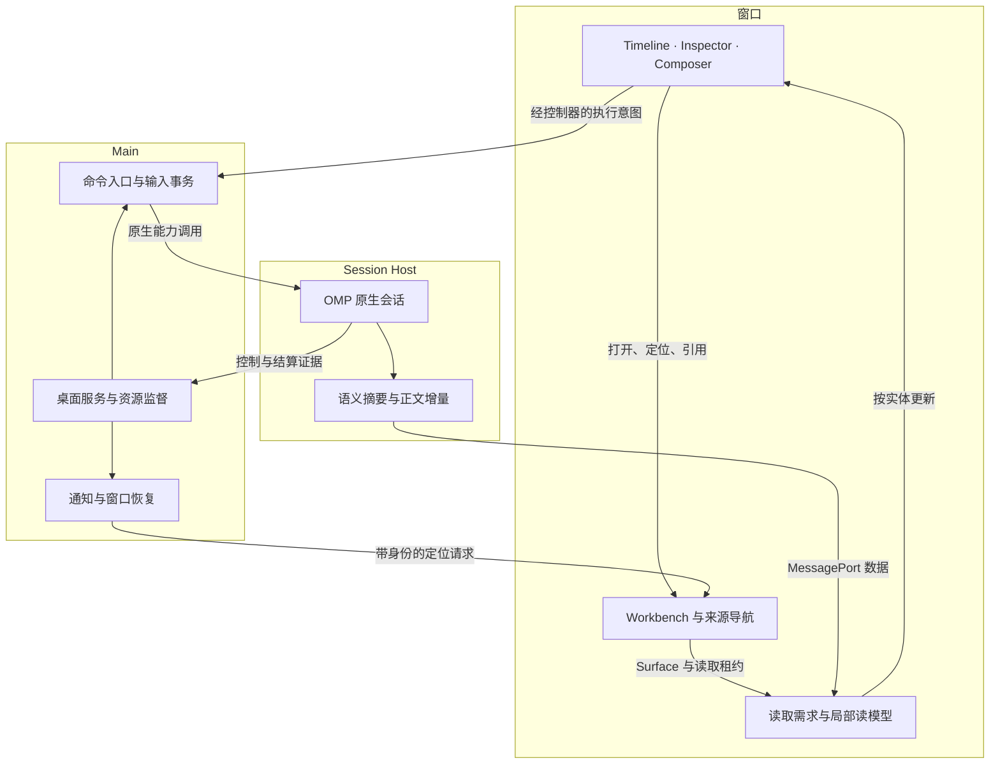

# D-PI Electron 会话组件与应用编排完整方案

**OMP 18.8.9 复审版 · 2026-10-11**

本稿完整替代上一版方案的架构建议与实施顺序。目标是让 D-PI 成为可以持续运行、可恢复、可组合的 Electron Agent 工作台，并据此建设工具、任务、问答、计划、成果和状态组件。它是一份可拆票实施的设计文档；本次完成了固定版本源码审查和隔离验证，没有修改产品代码，也没有把未运行的 GUI 或性能目标写成已通过的结果。

## 1. 这次复审改变了什么

**主线改为：先建立明确的应用编排、操作身份和资源预算，再让组件通过同一套来源、动作、导航、详情和输入合同协作。** 第一条交付必须贯穿真实用户流程，不能先交付一批互不相连的卡片，也不能先做一个没有用户功能的平台框架。

| 上一版判断 | 本次决定 | 理由 |
| --- | --- | --- |
| 现有阅读、输入和模型基本沿用，主要补专用组件 | 对旧实现逐项判定保留、改造或替换 | 已找到请求竞争、后台全文订阅、历史缓存无总量预算等具体问题 |
| ThreadWorkbench 下组合 Timeline、Dock、Composer、Inspector 即可说明编排 | 增加窗口范围的 Workbench、来源导航、请求控制、读取需求和资源管理 | React 组件树不能表达操作并发、窗口关闭、晚到结果、草稿目标和资源释放 |
| Inspector 主要记录当前查看来源 | 采用 Source 与 Surface 分离，支持临时预览、固定、返回和独立查看状态 | 同一资源可以被多个入口查看；关闭视图不能结束原生工作 |
| OMP TUI 包不进入 Renderer | 按模块依赖闭包判断；纯模块可直接复用，终端运行时不进入 Renderer | 图表纯模块确实可单独运行；NativeToolView 仍不是 RPC GUI 协议 |
| 共用一个 AttentionDock 安排全部状态 | 分开“需要用户行动”和“正在发生的活动” | 待答、审批与恢复事项不能被任务进度或队列计数挤掉 |
| 丰富引用主要留到后期 | 第一条工具详情闭环就接入最小冻结引用 | 尽早验证 Tool → Inspector → Draft → Timeline 的真实协作 |
| UI01–UI09 按组件族逐步补齐 | 采用 WB00–WB08，先修正确性，再完成工作台纵向闭环 | 避免在错误的请求模型、全文同步和局部回调上增加更多功能 |

### 1.1 对用户三点反馈的独立判断

**关于 Electron：** 你的重点应当落实在进程、窗口、资源和命令生命周期。D-PI 当前确实使用 Electron、React、Zustand 与 TanStack Query；Electron Renderer 的布局、渲染与输入性能仍遵循浏览器机制。把它当桌面应用，不要求弃用成熟的 Web 呈现技术，也不意味着把状态全部搬到 Main。Electron 官方同样强调 Main 不能被长任务阻塞，并明确支持通过 MessagePort 建立直接数据通道。[D01] [E01] [E02]

**关于中心化：** 应统一的是规则、身份、操作入口、资源租约和跨视图意图。完整正文、原生执行、编辑器 DOM、文件内容和每个组件的 hover 不应共享一个总 Store。D-PI 已有部分正确的应用基础；“完全没有中心化”不符合源码。[R01] [R02] [R08] [R09] [R10]

**关于旧代码：** 不为旧组件 API、旧投影结构或旧局部状态保留兼容层。可以修改 schema、重建派生缓存、删除旧分支、重划模块边界。但是请求过期、发送结果未知、历史不完整、文件版本变化仍然是现实运行状态，不能因为不需要兼容就消除这些状态。

### 1.2 证据基线

| 对象 | 固定版本 | 本次结论的适用范围 |
| --- | --- | --- |
| D-PI 可见远端 main | `1e73213ea81966e1979c58cad1b0342f34487381` | 重新 fetch 后仍为此提交，依赖固定 OMP 18.8.7；用于审查当前可证实现 |
| 用户本地系统 | 用户明确说明已全面升级至 18.8.9 | 作为方案目标；本次无法直接读取这部分本地修改，不推断升级没有完成 |
| OMP 18.8.7 | `f261ed9faf16b61880b544f599876bface4ded0d` | 比较起点 |
| OMP 18.8.8 | `1ca13863a82825bdce02908b3db9713e9b084290` | 中间版本，包含关键配置语义及 TUI 类型变化 |
| OMP 18.8.9 | `fa5ff4a3a977a28b93d025f4cf50f046e019f18c` | 本方案的官方能力基线 |
| T3 Code 本轮 | `e7db61f6799faf9d72a898567c52b1c954f2826e` | 最新独立 checkout；本文 T3 链接均固定到此提交 |

D-PI 可见依赖为 Electron 44.4.5、React 19.3.0、Zustand 5.0.15、TanStack Query 5.104.0、Effect 4.0.0。它们是已读取的仓库事实，不是要求重新选型的理由。[D01]

本轮 T3 比上一轮 `716357c…` 更新，但前稿使用的 16 个组件／合同文件逐一比对均未变；本轮重新检查了桌面窗口、Surface、布局、命令调度、通知和草稿编排。OMP 所有“新增”判断按两个 tag 区间核对，不把 18.8.9 之后的 main 能力混进来。

## 2. OMP 18.8.7 → 18.8.9：官方究竟提供了什么

### 2.1 需要改变设计或验收的差异

| 变化 | 首次进入 | 类型与真实边界 | D-PI 的处理 |
| --- | --- | --- | --- |
| `compaction.modelThresholds` 的普通数值成为策略计算的 base | 18.8.8 | **行为变化**。普通数字不再总表示精确触发点；固定点用 `f<tokens>`。全局 `compaction.thresholdTokens` 不要与此混为一谈 | 显示“配置值、有效窗口、实际触发点、依据”；检查已有设置的用户意图 |
| `baseWindowTokens` 与阈值 clamp 修复 | 18.8.8 | 固定点按实际 context window 校验；窗口边缘需要保留 reserve | 调用官方解析和计算，不在 GUI 手写一份 85% 规则 |
| compaction plan／preview／set helpers | 18.8.8 扩展 | `describeModelCompactionPoint` 原先已有；新增／扩展结构化预览和保存流程 | Host／配置服务复用 helpers，经 D-PI DTO 暴露给设置 UI |
| `ModelHubCallbacks.onCompactionPointChange` 改签名 | 18.8.8 | **TUI 类型 breaking change**：增加 confirmed，返回 typed result，代替错误字符串 | 只有复用／移植对应 ModelHub 代码才直接受影响；GUI 接确认流程，不复制“必须按两次 Enter”的终端交互 |
| `ModelCompactionPoint.percent → basis` | 18.8.8 | **TUI 类型变化**：展示依据改为 basis 文案 | 更新移植代码；需要数值语义时使用 structured trigger，不反解析 basis |
| `RenderResultOptions.elapsedMs/cancelled` | 18.8.8 | 官方展示层得到时长／取消信息；不是 RPC 自动新增同名字段 | 可作为 ActivityFrame 状态契约参照；只显示 D-PI 实际取得的执行时间与取消证据 |
| `NativeToolHead.command`，`preview: "children"` | 18.8.8 | 改进命令／子项展示语义；仍属于 Native/Tern 呈现模型 | CommandBody 和 TaskGroup 可吸收其摘要思路，不把 NativeToolView 当跨进程业务 DTO |
| OpenAI Responses/Codex 流式参数尾部空对象修复；恢复时 reasoning、compaction payload 修复 | 18.8.8 | 原生执行可靠性修复，不是新的卡片协议 | 回归“参数流入→执行→结果”、会话恢复与 compaction；不能以 GUI 兜底解析代替原生修复 |
| `/jobs kill` busy 时可用、`/usage` 已开时聚焦现有面板 | 18.8.8 | CLI/TUI 路径改进；并不自动成为 D-PI 的新 RPC command | Jobs 操作仍核 native API；Usage 的复用／聚焦行为可迁移到 Surface registry |
| fork 未结束工具的诊断语义改为 unknown outcome | 18.8.9 | 特定 fork 路径修复；没有新增统一 `outcome: "unknown"` 字段 | 核对 D-PI 是否调用对应入口，保留 provenance 和真实操作状态 |
| 移除 `isInsideTmux/Zellij/Herdr` exports | 18.8.9 | **TUI API breaking change**；改用 `hasTerminalMultiplexerSession(kind, env)` | 搜索适配代码的旧 import；没有使用这些函数就没有直接编译影响 |
| multiplexer registry、`openTerminal` 与 fork placement | 18.8.9 | 终端能力驱动的启动方式；RPC／headless 不因此获得 Electron 内嵌终端 | 外部终端启动可在 Host 复用公开 launcher／dispatcher；内嵌 PTY 及其 Surface 单独实现 |
| table chart 的 change／progress、fraction score 和绘图优化 | 18.8.9 | 纯图表管线早已存在，本次扩大语义和修复解析 | 在 RichContent 中使用薄 adapter 复用纯子模块，增加输入预算和有限数值校验 |

依据包括官方两个 release、固定版本 renderer、compaction、fork、chart 模块及其调用路径。[V01] [V02] [O01] [O04] [V03] [V04] [V05] [V06] [V07] [V08] [V09] [V10] [V12] [V14] [V20] [V24]

### 2.2 Compaction UI 应如何落地

增加 `CompactionPolicyEditor`，与 `ContextUsagePopover` 共用配置读取与来源说明，但区分两个问题：

- ContextUsage 回答“当前上下文和使用量是什么”。
- PolicyEditor 回答“按这套设置，什么时候触发压缩、在哪个窗口运行”。

Host 可从公开子路径 `@oh-my-pi/pi-coding-agent/session/model-compaction-threshold` 导入下列 helper；它由包的 `./session/*` exports 明确提供，根入口没有重新导出。使用 `session.settings` 和 `session.modelRegistry.contextWindowTiers(model)`，不把 Settings 的运行时依赖闭包带入 Renderer。[V03] [V13]

Host 侧使用：

```ts
describeModelCompactionPoint(scope, model)
// 当前 tokens、basis、source、draft。

planModelCompactionPoint(settings, model, input, tiers)
// 预览 { reset, window, trigger }，非法输入可能返回 undefined。

setModelCompactionPoint(settings, model, input, {
  tiers,
  confirmed,
})
// saved 或 confirm；也可能抛错。
```

GUI 需要显示 `trigger.kind`。固定模式显示实际 tokens 和可得的 `cappedFrom`；缩放模式显示 tokens、share、scaledFrom、fromBase。未知窗口、自动压缩关闭、无有效输入是独立状态。[V03]

例如，在官方默认策略适用且有效窗口足够大的前提下，普通 `400000` base 可对应 `340000` 的触发点；`f400000` 请求固定在 400000。18.8.9 的运行时计算明确区分：fixed 小于实际窗口时保持固定值，即使进入通常的 reserve 区间；fixed 大于等于实际窗口时才退到窗口的 prompt budget。设置 helper 对已知最大窗口还会先拒绝过大的 fixed 输入。不能把所有 fixed 都再扣一次 reserve，也不能在所有模型上无条件套用 85% 例子。[V01] [V03] [V04]

保存流程必须注意三件事：

1. `setModelCompactionPoint` 写的是 **global config**。存在 project override 时，不能把全局编辑伪装为当前项目已生效。
2. 打开 extended window 的确认绑定到具体 model、输入、配置版本和 tier。输入或模型变了，旧确认失效。
3. 某些高优先级覆盖检查可能在全局写入后抛错。因此“抛错”不必然意味着“完全未写入”；命令后重新读取有效配置并对账，不自动重试写操作。[V03]

D-PI 对外返回自己的结构化 `CompactionPreview / CompactionSaveResult`，不依赖英文 summary 字符串推断结果。这个 UI 值得复用官方计算，单独实现 Electron 的交互与配置作用域显示。

### 2.3 Fork 修复不能靠升级版本号宣称已经获得

可见 D-PI 的 `runtime/thread-history.mjs` 使用：

```ts
SessionManager.open(...)
createBranchedSession(leafId, { copyArtifacts: true })
```

OMP 18.8.9 的修复位于另一个入口：`SessionManager.forkFrom(..., { repairInterruptedTail: true })`；CLI `--fork` 显式启用它。`createBranchedSession` 的 options 没有这个 repair 选项，也不自动调用同一修复。[R11] [V05] [V06]

因此本轮结论是：**上游有真实修复，但当前可见 D-PI 的分支复制路径不能因此视为已经接通。用户本地 18.8.9 实现需要按实际调用再验收。**

也不能不经审查直接换成 `forkFrom`：需要同时核对截取 leaf、活动分支、parentSession、artifact 复制、成本／历史关系和未结束工具的处理。复制任意历史分支与复制运行中会话不是完全相同的操作。

一般 unknown 分支生成普通 `ToolResultMessage`，其中 `isError: true`、文字说明父会话可能仍在运行、结果未知；没有专用结构化 provenance 字段。另有两个重要例外：length 且调用无 startedAt 时保留 never-executed 的明确证据；源会话已有相应 process-exit 记录时跳过 fork repair，交给既有恢复路径。不能给所有 fork 尾部统一贴 unknown。[V05] [V06]

GUI 不能单凭 isError 将 unknown 分支显示为确定失败，也不能靠搜索英文 unknown 建立长期协议。D-PI 自己发起 fork 时，应记录具体受影响 call、active branch 和补入记录；仅知道“发生过 repair”不足以修改所有工具状态。外来历史无可靠关联时保持原文与覆盖说明。[V06]

### 2.4 哪些能力不是本次升级才出现

这会直接影响排期，不能把原来未适配的能力误算成上游刚刚支持：

- 两个版本区间中，核心 `modes/rpc`、ask、task 路径没有新增本方案所需的 GUI RPC 协议。Ask、Task、Jobs 仍需 D-PI 自身的类型桥接与展示。
- `getAsyncJobSnapshot / inspectAsyncJob / cancelAsyncJob` 等原生能力此前已有；本次应接入，而不是等待新版本。
- `UserMessage.liveSteered` 在旧版已经存在，用来标记历史消息被实时采纳；**队列快照**中的新 liveSteered 状态不能从 18.8.9 之后的 main 借来。18.8.9 的该队列快照只有 steering、followUp 两组数据。
- PlanProposal 不等于现成的“approve RPC”。准备计划、审核、退出 Plan mode、恢复工具／模型／上下文和安排下一步仍需要完整编排。
- NativeToolView 的描述式呈现并不意味着 RPC 会把这些对象下发给 Electron。[O05] [O06] [O17] [O18] [O20] [O22] [V11]

### 2.5 修订后的 OMP 复用准则

| 模块种类 | 选择 | 进入 D-PI 的位置 |
| --- | --- | --- |
| SDK 已提供的执行／状态／查询能力 | 调用原生能力，不重写同等调度 | runtime bridge、Main／Host 服务 |
| 无终端依赖的纯解析、图表规划、SVG 输出 | 精确子路径 import + 版本 adapter；构建验证后直接使用 | RichContent adapter，必要时 Worker |
| 依赖 Theme、ANSI、终端宽度、NativeChild 或 Tern 后端的 presenter | 提取／移植纯语义部分，React 重写视图 | OMP semantic adapter + feature renderer |
| 整个 TUI 生命周期和输入系统 | 不作为 React 控件内核导入 | 仅研究其行为和状态合同 |
| 自定义 extension 的任意 TUI widget | 只支持明确声明式协议子集 | ExtensionStatusRegion；其他显示不支持 |

`charts/table-data`、`charts/chart-plan`、`charts/chart-svg` 三个子模块已做定向验证：包 exports 可以解析，去除类型后可在没有 process、Bun、document、window、fetch 的环境中执行，生成 progress/change/bar SVG；标签文本转义探针通过。**这不等于 D-PI 的 Vite 生产构建已经通过。** 同时发现极大指数输入可进入 Infinity 并产生无效几何，因此 wrapper 必须限制 finite number、行列数和字符串长度，再调用图表管线。[V07] [V08] [V09] [V10]

复用的单位应是验证过的纯模块和稳定合同。既不要整包移植，也不要因为路径里有 tui 就放弃所有直接复用。

## 3. 现有 D-PI：该保留什么，哪些策略需要直接重做

### 3.1 按证据分级，而不是按文件是否存在分级

本节的“确认”指源码路径及可重复反例；“结构风险”指实现存在明确成本或生命周期缺口，但未在真实 GUI 上测出具体延迟／内存。二者不混用。

| 对象 | 判断 | 需要改变的内容 | 可保留的资产 |
| --- | --- | --- | --- |
| RuntimeModel 命令关联 | **替换，P0** | 用同一个 requestGeneration 接所有独立操作会吞较早失败；改为按操作和目标追踪 | 连接代次、Thread 身份、发布 revision 校验 |
| NativeInteraction、RuntimePanel | **重写状态拥有者，P0** | 填写值、sent latch、修正回答关联脱离 React；建立 InteractionDraft 与发送观察 | 输入／选择控件、原生题型展示零件 |
| ThreadModel 资源策略 | **改造，P1** | execution 状态镜像与正文读取需求分离；deactivate 降级正文订阅 | 应用拥有模型、卸载视图不结束执行 |
| Preload execution bridge | **替换分发策略，P1** | 每窗每类事件 parse 一次，按 Thread 路由；不让每个模型独立解析广播 | Zod 信任边界与命名桥接能力 |
| ConversationProjection | **改造传输，P1** | 摘要、状态 patch、正文增量分开；避免重复发送累计全文 | 稳定身份、批处理、final、seq／gap |
| SavedConversation / history queries | **重写缓存及补页策略，P1** | 页面／字节预算，按目标补页，增量索引；gap 不自动拉尽全历史 | live→native 接棒、原生来源和完整性判定 |
| ReadingWindow | **保留行为，改造内核策略** | 展开状态不再单独要求持续保留离屏正文 DOM；增量高度更新和观察器管理 | 选区、焦点、阅读锚点、动态高度处理 |
| ThreadContent 的 modal／panel 状态 | **替换组织方式** | 多布尔 modal、临时 selectionAttachment 改为 Surface 与输入意图 | WorkbenchFrame 的区域布局与宿主 |
| FilePanel / Monaco | **改造成按需 Viewer** | 未查看不启动重读；隐藏后降级需求，按有限 warm 预算保留或释放；目标／坐标由轻状态恢复 | 文件／Git 查询身份、Monaco dispose |
| Composer / DraftController | **保留编辑核心，改造跨面板输入** | 统一 FrozenContext、明确目标草稿、去重插入和持久化范围 | CAS 草稿、IME、Undo、附件导入及冻结边界 |
| Main ThreadAttention | **保留拥有者，扩展索引** | 多个 request 的目标、已读与行动状态分离；未来多窗才扩 presence | Main 独立通知、去重、有界镜像 |
| Main Runtime registry | **增加容量及 idle 政策** | native active/warm/cold 与 renderer cache 分开 | 单一监督者、执行授权、进程和证据清理 |
| File/Git 只读操作入口 | **保留并推广** | 将 operationId、取消、限额和 finalization 推广至历史／大详情 | 已有可信读取和取消的具体实现 |
| OMP 执行、原生历史和 App 输入事务边界 | **保留不变量，允许改目录／接口** | 减少无必要中间层，禁止 UI 自造原生事实 | 原生执行权威、ACK 与草稿消耗事务、未知状态不重发 |

源码依据：[D04] [D05] [D06] [D08] [D10] [D11] [R01] [R02] [R03] [R04] [R05] [R06] [R08] [R12] [R13] [R14] [R15] [R16] [R17] [R18]。

### 3.2 最紧急的反例：独立问答共用 latest-wins

当前 RuntimePanel 同时展示同一 Thread 的多条可答请求，每张卡只锁本卡按钮；RuntimeModel.answer 却复用该 RuntimeModel 实例内的同一个 requestGeneration。它不是全应用共享的计数器，但仍足以让同一 Thread 的独立操作相互覆盖。Main 的 commandsInFlight 是计数，不是阻止该竞态的全局串行队列。[D05] [R03] [R12] [R13]

| 时序 | 动作 | 当前实现可能留下的状态 |
| --- | --- | --- |
| 1 | A、B 都在等待回答 | 两卡都可提交 |
| 2 | 用户回答 A | A 本地 sent=true；generation=n |
| 3 | A 回包前回答 B | B 本地 sent=true；generation=n+1 |
| 4 | A 的传输或准入失败返回 | 因 generation 过旧而丢弃 A 的失败 |
| 5 | B 成功 | B 更新，A 仍可能 pending |
| 6 | A 卡继续挂载 | pending + 本地 sent 可显示“已提交”，缺乏 A 的失败／unknown 观察 |

读取生产 RuntimeModel 并替换 vendor／bridge 测试边界的隔离验证确认：单 A 失败会发布 `runtime.answerUnknown`；并发 B 后，同样的 A 失败不会发布。这里没有声称 A 被原生接受，也没有测量实际发生频率。

**目标实现必须删除“Promise<void> 返回 + 本地 sent 布尔值代表成功”的策略。** 连接 generation 用于区分连接，operationId／traceId 用于关联动作，requestId 用于定位题目；它们承担不同职责。用全应用串行队列掩盖竞态也不是合理修复：停止命令不应被长读取阻塞，不同请求不应互相丢结果。

### 3.3 四个确定性验证结果

| 验证 | 输入 | 结果 | 能证明什么 |
| --- | --- | --- | --- |
| Preload 分发 | 1／8／32 个 Thread 消费者，一个目标事件 | runtime、submission 各调用 safeParse 1／8／32 次，目标消费者为 1 | 当前解析入口调用数随订阅者增长；不是 Zod 耗时 benchmark |
| 独立回答竞争 | A 失败，期间并发 B | A 的 answerUnknown 被 latest-wins gate 丢弃 | 当前操作关联策略存在正确性反例 |
| 历史累积 | 1000 次各追加 4 KiB 的历史 refresh | 单 query 保留 1000 页、4,096,000 字节正文 | query 数量上限不能限制单会话内容总量 |
| 累计全文发送 | 最终 1 MiB，128 批，每批增加 8 KiB | 累计 text 为 67,633,152 字节，即最终正文的 64.5 倍 | 完整 put/flush 的数据量放大；不是实际 IPC 带宽、RSS 或掉帧测量 |

方法是读取并执行固定提交的生产 TypeScript，使用 Node 类型转换与显式测试适配器；未运行完整 Electron、真实 provider 或用户本地 18.8.9 集成。Projection 探针直接驱动生产 put／flush，统计 item.text 的 UTF-8 字节，不含 JSON／metadata，也不覆盖 native 帧解码与计时器调度。结果只用于支持对应策略的重做，不用于宣称整体应用已经缓慢。[R03] [R04] [R06] [D10]

### 3.4 三个容易被“已有组件”掩盖的成本

**后台模型存在，不代表后台只订阅摘要。** 当前 ThreadModel 首次观察 runtime 后连接 conversation，deactivate 没有断开正文。默认 8 项可驱逐缓存预算的计数包含 active Thread，未解决工作还可在预算外保留；这些未释放的模型都可能持续接收正文，不能将其理解为恰好只有 8 个后台项。[R01] [R02]

**虚拟列表存在，不代表所有内存与 DOM 都有上限。** SavedConversation 的 gap 会在不要求 sentinel 可见时继续 fetchNextPage；query cache 未给单会话 page／byte 上限。ReadingWindow 又会为 details 展开、aria-expanded 等继续挂载离屏行。未来丰富工具卡越多，单纯把卡片放进现有虚拟列表越不够。[R05] [R06] [R07] [D04]

**8 个 Thread 缓存不等于最多 8 个 OMP 实例。** Main 的 runtime prune 只释放满足退出／可重建条件的对象；releaseEligible 拒绝仍 connected 或 sessionStarted 的实例。当前可见路径未发现常规 idle TTL／全局 warm native 预算。这是容量策略缺口，不应称为已证实的内存泄漏。[R02] [R08] [R13]

## 4. Electron 应用的目标结构

### 4.1 四种 scope，先明确生命周期

| Scope | 典型拥有者 | 应持续到什么时候 | 不能由什么决定 |
| --- | --- | --- | --- |
| Application / Main | Desktop services、输入仓库、通知、RuntimeSupervisor、可信读取 | 应用进程退出或明确资源退休 | 某个 React 组件是否挂载 |
| Native runtime / Host connection | 原生连接、请求关联、工具执行、语义投影 | 明确退休或进程结束；重连产生新 connection generation | Inspector 是否打开 |
| Window | Workbench、导航、焦点、桥接分发、需求注册表、Query cache 容器 | 此窗口关闭／Renderer 重建；具体读取 lease 随需求释放 | 不能因 Thread 切换销毁整个窗口注册表 |
| Thread / Resource / Editor | 草稿、回答草稿、活动索引、详情读取、编辑会话 | 各自明确的身份、租约和预算 | 一概归入 App singleton 或 useState |

Native session 的持久身份、历史和不可变来源可以在进程关闭后继续存在；warm→cold 释放的是安全可重建的运行资源，不删除这些历史，也不让 durable SourceRef 依赖临时连接代次。

首版继续采用一个工作台窗口。把 windowId、source、draftId 区分清楚即可，不因 Electron 一词提前建设多工作台同步框架。当前 D-PI 和本次读取的 T3 主应用都以单 main 工作台为主；辅助 BrowserWindow 并不证明完整的多工作台协调能力。[R09] [T24]

### 4.2 管理职责，而不是再造一批大 Store

下面是实现角色，可以用小模块、现有 service、vanilla store 与纯函数组合，不要求一行一套框架。

| 角色 | 主要职责 | 对组件提供的合同 | 不应拥有 |
| --- | --- | --- | --- |
| **DesktopServices / RuntimeSupervisor** | 原生准入、进程监督、可靠命令入口、持久化、窗口恢复、资源容量 | 命令结果、能力、状态摘要、read operation | DOM、hover、逐字符编辑状态 |
| **WindowBridgeDispatcher** | 每窗每通道唯一监听；验证一次，按领域／Thread 路由 | typed subscriptions、connection epoch | 消息正文总仓库、执行调度 |
| **WorkbenchModel** | Surface 集合、激活、布局意图、overlay、用户意图版本 | open/reveal/pin/close、窄 selectors | 文件正文、日志、原生 pending 的权威副本 |
| **SourceNavigation** | 来源解析、补页、展开组、定位、返回、竞态取消 | NavigationTicket、revealSource、back/forward | 所有资源读取的内核 |
| **ResourceDemand / ReadCache** | 按可见视图合并需求、读取去重、取消、预算、休眠 | 可释放 lease、paged detail、coverage | 停止 Agent 的决定、重试执行命令 |
| **ActivityReadModel** | 规范化实体、父子关系、组摘要、状态与来源索引 | rowIds、rowById、groupSummary、sourceRefs | 第二套 Agent task scheduler |
| **InteractionController / OperationLedger** | Controller 管题目草稿与发送门；Ledger 管按目标索引的操作观察和结果 | draft selector、respond、typed result | 捏造原生 ACK、由卡片推断成功、把日志正文装入 Ledger |
| **DraftContextCoordinator** | 将冻结的资源片段插入明确草稿；处理版本、去重、编辑 handle | insertContext、capture、flush | 依赖“请求完成时当前 Thread”猜目标 |
| **AttentionIndex / ActivitySummary** | Main 从 Host／native 事实构建 attention 摘要；Window 选择处理项；活动摘要独立呈现 | attention targets、counts、current decision | 用一个状态值混合问题和后台进度 |

对应的实际基础可从 D-PI app wiring、Main services、ThreadAttention、DraftController 和 Host projection 改造；不是另建平行的应用运行时。[R01] [R02] [R08] [R10] [R14] [D10]

### 4.3 控制路径与数据路径



Main 负责可信入口、资源准入和监督；高频正文仍通过 Host → Renderer 的受控数据通道。当前 D-PI 已经转交 MessagePort 给 Host，应该改进流与需求合同，而不是把正文绕回 Main。Electron 官方明确支持这种直接通信方式；transfer 使用 postMessage，而不是普通 invoke/send。[R19] [E02]

历史／artifact 读取也应经过可信入口。当前历史已有单页／单记录上限，仍需补齐取消、并发额度与主线程解析预算；大块解码和结构解析可交给有界读取 worker。Main 验证身份和范围、调度操作、复核结果来源版本；Markdown、高亮和大 Diff 等呈现计算不进入 Main。[R16] [R17] [D11] [E01]

### 4.4 T3 值得借鉴的组织方式及限制

| T3 源码模式 | 为什么适合 | D-PI 的采用方式 |
| --- | --- | --- |
| rightPanelStore 只存 descriptors、order、active | Surface 集中编排，资源继续归 feature | 作为 WorkbenchModel 的核心原则 |
| 面板互斥在同一次 state update 完成 | 避免多个 effect 在一帧内互相开关 | 一个纯 reducer 原子更新 surface／overlay／layout 意图 |
| expectedUserActionRevision | 防止晚到自动打开抢走用户新选择 | 自动定位／打开必须携带 intent revision |
| ChatCanvas 集中测量可用空间 | 卡片只上报占位，几何统一求解 | 改造现有 WorkbenchFrame，保留单一布局拥有者 |
| keyed query／command scheduler 与窄 selector | 共享读取，区分 parallel／serial／singleFlight／latest | 保留 Zustand／Query，吸收明确并发策略 |
| Draft context insertion handler | 将跨面板反馈送入目标草稿 | 复用 D-PI DraftController 与受限 editor handle |
| ThreadFindProvider 下沉 | 搜索高亮不影响 Composer 和全工作台 | 导航规则集中，快变高亮仍留在阅读层 |

依据：[T17] [T18] [T19] [T20] [T21] [T22] [T23] [T28]。

T3 的 renderer 单例 Store／localStorage 不是多窗口写入协议；renderer 中的通知 coordinator 也不是关窗后仍有效的通知 owner。D-PI 已有 Main 通知、草稿 CAS 和 Host 生命周期，应保留这些更适合当前应用的责任。T3 当前 ChatView 超过一万行、composerDraftStore 超过四千行；行数不证明性能差，但也不能把其整文件组织当作“优雅中心化”的模板。[T22] [T24] [T25] [T29] [R10] [R14]

## 5. Source、Surface、动作与状态：先冻结这些最小合同

以下类型是 **D-PI 目标合同示意**，不是声称 OMP 已经导出这些接口。名称可以调整，身份、状态含义与拥有者不能含糊。

### 5.1 资源身份与查看实例分开

`SourceRef` 表示“内容从哪里来、具体是哪一版”；`SurfaceId` 表示“这个窗口里打开的查看实例”。同一来源可在时间线内展开、Inspector 临时查看或被固定，完整内容由一个版本化读取缓存共享。

```ts
type SourceRef =
  | {
      kind: "native-record";
      nativeSessionKey: string;
      nativeRecordId: string;
      revision: string;
    }
  | {
      kind: "native-artifact";
      nativeSessionKey: string;
      artifactKey: string;
      revision: string;
    }
  | {
      kind: "live-tool";
      nativeSessionKey: string;
      connectionGeneration: string;
      toolCallId: string;
    }
  | {
      kind: "app-supplement";
      supplementId: string;
      revision: string;
    };

type RequestKey = {
  threadId: string;
  nativeSessionKey: string;
  connectionGeneration: string;
  requestId: string;
};

type JobTarget = {
  nativeSessionKey: string;
  ownerScopeKey: string; // Host 解析的真实 owner／运行实例范围
  jobId: string;
};

type SourceTarget =
  | { kind: "activity"; activityId: string; source: SourceRef }
  | { kind: "request"; request: RequestKey }
  | { kind: "job"; job: JobTarget }
  | { kind: "file"; file: WorkspaceFileRef }
  | { kind: "diff"; diff: VersionedDiffRef }
  | { kind: "subagent"; subagent: NativeSubagentRef }
  | { kind: "artifact"; source: SourceRef };

type Surface = {
  id: string;
  target: SourceTarget;
  presentation: "peek" | "pinned";
  placement: "inspector" | "workspace" | "bottom";
  origin?: ReadingAnchor;
  viewState: SurfaceViewState;
};
```

WorkspaceFileRef、VersionedDiffRef、NativeSubagentRef 各自定义 required keys，组合时保留领域身份，不做几十个 optional 字段的通用资源袋。文件引用至少分开当前工作区文件与不可变快照；Diff 必须带 old/new 或来源 revision 与 side；Subagent 保留真实 native/task 身份，而不是新建一个伪 App Thread。

Renderer 使用不透明来源键，Main／Host 负责解析路径、Thread、原生会话和版本。大文件路径不能绕过已有只读操作入口。现有 file-selection、source coverage 和 native history 合同可以提供基础，但新 contract 不需要迁就旧 UI payload。[D11] [D13] [R16] [R17]

**Live 来源采用稳定实体身份，内容 revision 单独演进。** live-tool 的读取 key 使用会话、连接代次与 toolCallId；reader 维护 contentRevision／offset，不把每个 token 变成新 Source 或 Surface。不可变 record/artifact 的 revision 进入缓存 key；固定摘录与 FrozenContext 使用明确的内容版本。

Native record ID 只有在原生提供或可信历史解析获得时才写入，不能用 UI 自增序号伪造。Host／history adapter 依据真实调用或记录关联维护 live→persisted 映射；完成后切换 reader 来源，SurfaceId、成员锚点和用户展开状态保持。关联不到持久来源时，保留 live-only／coverage 状态。打开历史版本的查看实例则按 Source＋版本去重；同一 live 实体按稳定身份去重，视图可以明确选择“跟随实时”或“冻结快照”。[D11] [O05] [V18]

### 5.2 Workbench 操作的确定行为

| 操作 | 目标行为 |
| --- | --- |
| peek | 一个可复用临时查看位；打开新目标可替换当前 peek |
| pin | 将此查看实例固定；保留来源 Thread 标签与返回锚点 |
| reveal 已存在的目标 | 聚焦既有 Surface 并应用新定位；不重复堆叠同一详情 |
| close | 关闭查看实例、归还焦点、释放其读取 lease；不取消工具或 Job |
| 切 Thread | 当前阅读切换；显式固定的窗口 Surface 保留，其他轻状态按 Thread 记录 |
| 窄窗口变 sheet | 同一个 Surface 改 placement／呈现，不新建第二份控制器与表单 |
| 资源不可恢复 | 保留标题、来源与原因；显示 available action，不伪装成空成功 |
| 返回 | 根据来源锚点补页／展开／定位；原 DOM 不存在时由阅读适配器 materialize |

固定 Surface 默认属于窗口，来源属于其明确的 Thread／项目。点击“引用到输入”时默认目标必须在操作时明确捕获，并在 UI 显示；如果当前草稿与来源 Thread 不同，展示目标，不在异步结束时偷偷切换目的地。

### 5.3 导航有 ticket，自动展开服从用户意图

```ts
type NavigationTicket = {
  windowId: string;
  activationId: string;
  target: SourceTarget;
  intentRevision: number;
  phase:
    | "resolving"
    | "loading"
    | "revealing"
    | "settled"
    | "unavailable"
    | "superseded";
};
```

用户动作推进窗口的 intentRevision；自动动作携带 expectedIntentRevision。打开 A 后用户又打开 B，A 的晚到内容可以进入正确缓存，但不能重新激活 A。关闭 Inspector 后的旧读取同样不得复活面板。导航取消只取消读取／定位，不撤销已经派发的原生执行。

SourceNavigation 负责状态转换，具体步骤委托给领域 adapter：历史补页、活动组展开、列表 materialize、文件／Diff reveal、滚动与焦点。持久导航记录不保存 HTMLElement；DOM Range 与测量数据仅存在于当前视图。T3 的 proactive panel revision 和 find navigation 提供了具体参照。[T17] [T23]

### 5.4 操作结果与 RuntimeView 分开

RuntimeView 是最新可读事实；OperationLedger 记录“我发起的这个动作到哪一步”。旧 snapshot 可拒绝覆盖新 snapshot，但其中某个独立操作的结果不能被另一个操作覆盖。

建议键包含 threadId、connectionGeneration、operationKind、目标 requestId／jobId 等，以及 operationId／traceId。不同粒度的 key 负责不同互斥规则，不用一个递增数字承担全部职责。

| 维度 | 推荐状态 | 依据 |
| --- | --- | --- |
| 本地意图 | editing、validating、blocked | 本地表单／准入 |
| 发送观察 | not-dispatched、dispatching、written、unknown | Main／Host 的具体观察 |
| 原生请求存在性 | pending、ended、unobserved | 原生事件或明确 Host 镜像，不从按钮点击推断 |
| 执行结果 | succeeded、failed、cancelled、unknown、not-observed | 该工具／任务真正的完成证据 |
| 内容覆盖 | complete、partial、truncated、unavailable | 来源和读取结果 |
| 需要行动 | needs-answer、needs-review、needs-recovery、none | 对事实的展示策略 |

**普通 answer 的 written 只表示 Host 将 frame 交给本地 stdin Writable，调用未同步抛错；不保证已经 flush、对端已读取、原生接受或执行成功。** 当前 NativeSession.write 未等待 write callback／drain，新的命名必须保持这个弱保证。[R21] 建议直接把目前容易误导的 answer `acknowledged` 命名改为 `written`，不保留旧别名；真正 SubmissionReceipt 的 accepted／acknowledged 含义继续由其原有证据决定。原生 cancel 没有原因时，只能确认请求结束，不能确认是用户取消还是原生默认发生。[R03] [R12] [O18]

同一个 request 的本地双击由 controller 原子拒绝重复提交；跨窗口时最终发送门必须在 Main／Host。不同问题的操作结果独立更新。明确未派发可回到编辑；派发结果 unknown 时保存回答、显示核对入口，不能自动重发。

### 5.5 并发策略按动作定义

| 动作 | 策略 | 边界 |
| --- | --- | --- |
| 同一不可变详情读取 | 同 key single-flight | 共享数据；Surface 激活仍分别判定 |
| 搜索、预览、导航 | latest + abort／ticket | 只丢过时读取与呈现，不丢执行事实 |
| 队列编辑／重排 | 按 Thread 与 revision 串行／CAS | 原生队列仍是执行权威 |
| 回答同一请求 | 按 RequestKey 单次 admission | 不把不同请求错误合并成 latest |
| 配置写入 | 按配置作用域串行＋版本复核 | 查询预览可 latest；写入不自动 retry |
| stop／cancel | 独立控制路径 | 不排在日志读取、全文搜索或计划审核后面 |
| 子任务／后台 Job 调度 | OMP 原生机制 | GUI 管理能力入口，不自建第二套 agent scheduler |
| 引用插入草稿 | draftId + context operationId | 防重复插入；不等于原生 prompt 的幂等保证 |

T3 的按作用域调度值得借鉴，但无需照搬 Effect atom 实现；当前 D-PI 的 Zustand、Query 与 Host 的 Effect scope 已能承载这些边界。[T19] [T20] [D01]

### 5.6 冻结上下文：所有反馈共用一个入口

```ts
type InsertContextIntent = {
  operationId: string;
  draftId: string;
  expectedDraftRevision: number;
  context: FrozenContext;
  placement: "caret-if-owned" | "append";
};

type ContextProvenance =
  | { kind: "native-content"; source: SourceRef }
  | { kind: "file-excerpt"; file: FrozenFileRef }
  | { kind: "diff-excerpt"; diff: FrozenDiffRef };

type FrozenContext = {
  provenance: ContextProvenance;
  contentRevision: string;
  excerpt: string;
  selection?: SourceSelection;
  title: string;
};
```

ContextProvenance 是不可执行的纯来源合同，与 SourceTarget 分开。SourceRef、FrozenFileRef、FrozenDiffRef 等基础 ref 放在合法的 resource/contracts 叶子模块，不 import execution、input、app 或 React；input 的持久化合同只依赖这一叶子。SourceTarget 留在应用编排层组合 RequestKey、JobTarget 等领域目标，由 adapter 将 provenance 解析为导航目标。这样避免现有 execution→input 再反向依赖形成循环。[D16]

FrozenFileRef 与 FrozenDiffRef 明确包含冻结的内容身份、版本与必要定位，不引用当前 Viewer；Selection 使用纯坐标／摘录类型。流程为：捕获来源及目标草稿 → 冻结所选内容和版本 → 验证内容预算 → 通过 DraftController 插入 → 更新引用 chip／预览 → 由既有草稿持久化与发送事务处理。

编辑器挂载时只提供受限的 caret 插入 handle；未挂载时对目标 draft 做语义插入。不要用 Tiptap 实例或临时 React state 在 FilePanel、工具卡和 Composer 间运输业务对象。

现有 `[d-pi:file-selection:v1]` 及 fileReference 是文件选择专用合同，不能把工具输出、消息和 Diff 反馈伪装成文件选区。新的 union、序列化、附件／引用冻结和提交准备必须一并修改。若消息选择没有可靠的 Markdown 源 offset 映射，保存摘录和消息来源即可，不能伪造精确源码范围。Diff 反馈则必须保存 side、范围与版本，不只保存当前行号。[D13] [D30] [D31] [D32] [R14] [T07] [T11]

**流式内容的选择必须有冻结协议。** FrozenContext 的 excerpt、来源和 contentRevision 必须来自同一次一致读取。选区期间可短暂冻结被选择的可视段／revision，继续接收模型事实与其他片段更新，并提示有新内容；不能冻结整个 Agent 流。结束选择或点击引用时，在受控事务内读取选中文字和对应版本。若替换／虚拟化已破坏映射，要求重新选择或退为明确的摘录来源，不能拼接旧 offset 与新正文。缓存中的数据可以继续更新，当前 selection snapshot 在使用结束后释放。

表单 IME composition 期间不自动转交编辑 owner 或替换输入树；native 到期仍照常处理并更新事实，同时保留可恢复草稿。焦点、选区与原生请求有效性属于三个不同维度。

## 6. 资源与性能：组件装配前就必须有的规则

### 6.1 需求决定读取，原生工作独立持续

| 状态／消费者 | 保留什么 | 暂停或释放什么 |
| --- | --- | --- |
| 正在阅读当前 Thread | 可见范围、少量 overscan、活动摘要与必要 tail | 远处可重读大正文、高成本离屏渲染 |
| 后台 Thread 正在运行 | 状态、待答、失败／完成、队列／Job 摘要 | 无消费者的全文分发、Markdown／Diff 解析 |
| 固定 Inspector 正在查看某工具 | 该资源专属 reader 与详情增量 | 无关 Thread 的完整 transcript |
| 窗口隐藏／最小化 | Main 的执行监督、请求期限、系统通知；必要摘要 | 非必要动画、DOM 测量、搜索高亮与大视图重算 |
| 导航等待历史定位 | 有限期限、明确范围的临时 lease | 定位结束／取消后的临时读取 |
| 用户有选区／焦点／表单 | 保护必要 DOM 和编辑内容 | 其他可重建资源，不牺牲正在编辑的尾部 |
| 只有展开状态，没有交互占用 | 保存 expanded/tab 等轻状态 | 可释放离屏 DOM，滚回恢复 |
| 所有消费者关闭 | 可重建索引／短期缓存按预算保留 | 读取连接、Viewer、媒体 URL、Observer |

需求注册表属于 WindowRuntime；具体 lease 随最后一个需求消失而释放。不要把“ThreadModel 不随路由销毁”理解成“所有读取永远不断开”。

窗口隐藏时不依赖 Renderer timer 执行原生超时、默认回答或可靠提交。Electron 默认会对后台页面的动画和 timer 做节流；关闭 backgroundThrottling 还可能影响整个窗口中其他 webContents 的绘制，不能把它当解决业务持续运行的通用开关。[E03]

### 6.2 一次验证、按身份路由

对 runtime:state、submission:state 等广播，每窗每类一个 listener，在跨信任边界时验证一次，随后按 threadId／requestId 分发。各 Thread 的独立 MessagePort 仍按端点管理，不为统一分发再汇成全应用正文总线。按模块保留小 Store 与 selector，避免父组件订阅完整 RuntimeView。

“一次验证”不意味着删除不同信任边界所需的检查。Main 的来源权限、Host 的协议解析、Preload 的入站 schema 各有职责；要去掉的是同一份已进入窗口的事件，因为 N 个消费者而重复 N 次解析。[R04] [R19]

### 6.3 高频数据分三个层次

1. **可靠事实事件**：工具 start/end、请求到达／结束、提交证据、错误、最终正文等。必须保序；无消费者时仍进入权威状态或可恢复记录，不能被 progress 合批吞掉。
2. **可合并状态**：当前工具名、计数、进度百分比等。同一实体的可覆盖状态可按显示节奏合并。
3. **正文增量**：使用 block append／text revision／chunk stream。允许合并连续 append，但不能丢中间片段后只留最后一段。

每条 demand stream 拥有明确的 watermark／generation。主动不订阅某段正文属于覆盖选择，不等于 seq 丢包。恢复时以 source／revision／快照和必要尾部尝试补齐；无法恢复的部分保留 coverage gap，不让旧连接片段拼进新正文。

**OMP partialResult 不等于追加文本。** task 等工具可能每次返回当前完整快照，bash 预览也可能是滚动尾部。Adapter 必须区分 append、replace、snapshot、final；只有能证明追加语义时才 append，否则使用有版本的替换／快照。不能把累计快照一遍遍拼接。[V16] [V17]

长内容的摘要、正文与状态分离；final 提供最终快照或来源引用，并明确 coverage。只有确实取得完整输出或可验证的完整 artifact 时才标为 complete。预算计费增量更新，避免每批 JSON.stringify 全部累计正文。需要替换旧投影 DTO 时直接版本化并重建派生缓存，不为旧 UI 格式加永久双轨。[D10] [R05] [R06]

### 6.4 历史、详情和 Viewer 各有预算

至少分别管理四类预算：

| 预算 | 核算对象 | 达到预算时 |
| --- | --- | --- |
| 历史正文 cache | 实际驻留 page／body bytes，而非 query 数 | 回收远离视口且可重读正文，保留轻索引和锚点 |
| 详情 cache | 输出 chunk、JSON、图片、Diff、artifact | 释放无 reader 的大资源，保留 source 与摘要 |
| 挂载／Viewer 预算 | DOM 行、Monaco models、媒体、Worker task | 保留必要交互占用；闲置 Viewer 休眠／销毁 |
| native warm 预算 | 已启动会话、后台 Job、未决请求／证据 | 仅冷却确认可恢复的 idle 实例；不按 LRU 杀活跃工作 |

初始工程参数可以设为受配置控制的 page／byte 上限和短期 warm 时间，通过实际基准机校准。本文不把某个任意 MiB 数字宣称为最佳实践，也不沿用旧文档预算就推断现有代码已经实现。

Native warm 回收必须同时考虑 busy、admitted、队列、后台 Job、待答、命令 in-flight、证据未持久化、进程清理／lease 状态。仅 `busy=false` 不足以证明可退出。冷却是释放可恢复资源，不能替代用户的停止／取消语义。[R08] [R13]

### 6.5 历史与详情读取共用可信的读取设施

推广现有 File/Git 的 operationId、traceId、并发限额、取消与 finalization；history、artifact、subagent transcript 和大工具详情使用同等级合同。取消发出后，在底层操作真正结束前不能立即认为资源槽已释放。

HistoryQuery 需要支持范围／尾部或有界位置索引。当前 API 若只能向后扫描，就先改善读取能力；不要用自动拉取所有历史制造“看起来无缝”的前端。较大 JSON／历史解析迁到受监督的读取 worker，Main 保留准入、路径和源版本校验。[R16] [R17] [D11]

### 6.6 一个常被忽略的实时详情问题

T3 的 itemDetail 在运行时采用固定 live key，主要语义是运行期取一次、结束后再取一次。这个设计避免每 token 新 query，但不天然提供持续滚动日志。[T04] [T05]

如果 D-PI 的 Inspector 承诺“实时日志”，打开时应先拿有界快照，再按该资源的 revision／offset 接增量；关闭时释放 reader，结束时对账 final。只复制固定 key 与 staleTime 会得到看似实时、实际静止的详情页。

## 7. 完整组件目录：38 个能力单元及其编排位置

编号 C01–C34 延续上一版，C35–C38 是本轮补充的桌面编排／配置入口。它们是可规划的能力单元，不是宣称有 38 个组件都完全没有实现。状态来自正式渲染与调用路径；“桥接”意味着上游已有相关事实／能力，但 D-PI 尚需自己的协议、读取或控制路径。

共同基础来自 D-PI 现有 Conversation、ToolResultFrame、SubagentMessage、QueueControls、NativeInteraction、FilePanel、ReadingWindow 和输入系统。[D02] [D03] [D04] [D05] [D06] [D07] [D08] [R12] [R14] [R15]

### 7.1 活动结构与统一查看

| 编号／组件 | 当前判断 | 作用与典型场景 | 必备交互及编排 |
| --- | --- | --- | --- |
| **C01 ActivityRow / ActivityGroup** | 正式活动分组缺失 | 连续 read/search 压成可扫描过程，避免满屏同等权重日志 | 展开成员、显示失败／等待数、定位成员；通过 ActivityReadModel 分组，ReadingWindow 只消费稳定 row key |
| **C02 ToolUseCard / RendererRegistry** | 通用框已有，语义分发需重做 | 所有工具共享身份、状态、目标、元信息和操作，按有效操作选正文 | toolCall 生命周期不换卡；未知类型和 renderer 异常可降级；卡片只发 ActionIntent |
| **C03 ToolDetailInspector** | 正式能力缺失，已有零散详情 | 查看长输出、参数、结构化结果、媒体和出处 | peek/pin、独立分区、搜索／复制、实时 reader、返回；由 Surface/ReadCache 管，不在卡片内各开 modal |
| **C04 ResourceLink / SourceBadge** | 局部入口已有，需统一 | 从工具、结果、错误跳到文件、URL、artifact 或历史证据 | 短名、完整提示、版本／来源、定位范围；统一 SourceNavigation，不拼 DOM selector |
| **C05 CoverageNotice / UnavailableBody** | 部分提示已有，需重新建模 | 用户知道是 UI 裁剪、原生截断、尚未读取、来源已丢失还是读取失败 | 有可读来源才给“读取更多”；重试读取与重跑工具分开；所有 Body/Inspector 共用 |
| **C06 TurnActivityGroup / TurnOutcomeSummary** | 缺失 | 一次用户请求的工作过程、结果、未决事项形成可读整体 | 过程折叠、结果常显、失败与后台工作摘要；只读投影，不新建执行结算者 |

C06 的“轮次”必须按真实关联定义。OMP turn、一次 App submission、一次用户可感知工作过程与 T3 Run 不是天然同义。缺少关联时显示未归组活动，不按时间接近强行归属。[D13] [T06] [T09] [T10]

### 7.2 常用工具的专用 Body

| 编号／组件 | 当前判断 | 作用与典型场景 | 必备交互及编排 |
| --- | --- | --- | --- |
| **C07 CommandExecutionBody** | 专用 Body 缺失 | bash／脚本运行：命令、cwd、运行时长、输出、退出码、转后台 | 命令与输出独立折叠；状态脚常显；复制／引用片段／看完整日志；取消须有精确原生目标 |
| **C08 ReadResourceBody** | 专用 Body 缺失 | 文件、目录、图片或内部资源读取 | 展示范围／行号／目录条目／图片预览；点击来源定位；区分历史读取结果与当前文件 |
| **C09 FileChangeBody / DiffPreview** | 工具内缺失，文件 Diff 基础已有 | edit／真实文件 write／多文件修改 | 展示实际 patch、增删、移动、partial change；展开 hunk、查看快照、打开当前文件、引用反馈 |
| **C10 SearchResultsBody** | 专用 Body 缺失 | grep/find/glob 等代码检索 | 查询条件、范围、按文件分组命中、行预览、结果内过滤；定位走 SourceNavigation，说明覆盖上限 |
| **C11 WebResearchBody** | 缺失 | web_search／fetch／URL read | 来源列表、标题、摘要、抓取状态、最终 URL；复制引用、查看正文、经受控入口打开链接 |
| **C12 DiagnosticsBody** | 缺失 | LSP/typecheck 诊断、符号与引用定位 | 严重度／文件筛选、范围跳转、加入修复上下文；复用 ResultList 与 ResourceLink |
| **C13 StructuredToolBody** | JSON 兜底已有，需改造 | MCP、自定义和未知工具 | 显示工具／服务器、bounded 参数、文本／JSON／图片；可复制原始可得内容；单卡失败不击穿时间线 |
| **C14 ArtifactResultBody** | 附件基础已有，工具产物桥接不足 | 图片、文档、生成图表、可导出的结果 | 缩略图、按需预览、来源、保存／打开／引用；资源由 Artifact reader 管理，关闭释放本视图的媒体 lease／DOM |

这一族的共用件应是 ResultList、CodeExcerpt、OutputViewport、DiffHunkPreview、ResourceLink、CoverageNotice 与 ActionBar；不要为每个工具复制完整卡片骨架。OMP read/write 的有效操作必须先解包，详见第 8 节。[O01] [O02] [O03] [O08] [O10] [O13] [O14] [O15] [O23] [O24]

### 7.3 计划、任务、子代理与后台工作

| 编号／组件 | 当前判断 | 作用与典型场景 | 必备交互及编排 |
| --- | --- | --- | --- |
| **C15 TodoProgress / TodoList** | 专用能力缺失 | 持续显示计划步骤及完成情况 | 时间线保留本次变更，ActivitySummary 显示当前摘要；展开条目；完成数不冒充时间预测 |
| **C16 TaskGroupCard** | 缺失 | 一次委派产生多个真实子任务 | 父调用标题、成功／失败／运行分布、成员展开、汇总结果；按 parent call/task ID 建索引 |
| **C17 SubagentCard** | 已有，重构 | 看某个子 Agent 的任务、模型、当前工具与结果 | 接统一状态／来源／操作；进入 Inspector；不为查看自动创建 App Thread |
| **C18 SubagentInspector** | 缺失，需读取桥接 | 深入查看子任务 transcript、进度和结果 | 主／子返回、按需历史、partial 标记；steer/cancel 只在确实支持且目标有效时提供 |
| **C19 BackgroundJobsDock / JobRow** | 只有摘要／计数基础，缺管理闭环 | dev server、长命令、监控／后台 Job | 列出所属 session／owner 与 jobId、输出、状态；精确查看／取消；结束与结果投递分别呈现 |
| **C20 PlanProposalCard / PlanReview** | 缺失，需完整 workflow | 审阅具体版本计划并决定批准／反馈／继续修订 | 来源和版本、全文、复制／保存、反馈、审批；批准状态与下一步执行状态分开 |

TaskGroup、Todo、Plan、Subagent、Job 共用外壳和列表零件，但必须保留独立业务模型。Todo 是步骤状态；TaskGroup 是委派结构；Subagent 是执行主体；Job 是后台工作；PlanProposal 是待审核方案。绿色组摘要不能遮住某个失败成员。[O09] [O17] [O22] [O25] [O26] [O27] [T01] [T02] [T03]

### 7.4 需要用户行动与运行状态

| 编号／组件 | 当前判断 | 作用与典型场景 | 必备交互及编排 |
| --- | --- | --- | --- |
| **C21 InteractionCard / AnswerHistory** | 旧表单存在，状态策略须替换 | 用户回答后还能看到题目、回答及发送观察 | 受控表单、独立 RequestKey、草稿保持、written/unknown、真实历史来源；Timeline/Dock 共享 controller |
| **C22 MultiQuestionForm** | 缺失，需 ask_dialog 桥接 | 多题、多选、预览、自填，以及原生提供的特殊答案 | 题间导航、草稿、验证、原生编码；超时/defaultAnswer 遵从 native 语义，不能硬套旧 select |
| **C23 PermissionApprovalBody** | 普通确认基础已有，专用能力需桥接 | 审批某个真实工具、权限或资源范围 | 展示准确目标和作用范围；只提供 native 真有的选项；无可靠 toolCallId 时独立呈现 |
| **C24 DecisionDock / AttentionDock** | Main 提醒已有，处理区需重构 | 汇总需要用户回答、审核、恢复的事项 | 一个当前处理表单，其他事项可切换；保留用户选择；dismiss 通知不结束原生请求 |
| **C25 LifecycleEventRow** | 分散状态已有，需统一投影 | compaction、retry、stop request、interrupted、model change | 时间、原因、阶段、尝试数；来源明确；消息结束与整体结算不混同 |
| **C26 RecoveryActionPanel** | 旧 RuntimePanel 已有入口，需重组 | 断连、来源不可读、操作 unknown、证据缺口 | 重新连接、核对历史、查看操作、保留输入；基于事实给可执行动作，不默认重新发送 |
| **C27 ContextUsagePopover** | 专用能力／桥接不足 | 查看当前窗口、输入占用、usage／cost、压缩、配额 | 标明采样时间与来源；unknown 不估算；接 C37 的策略编辑，不把累计计费 token 当上下文占用 |

状态正文、请求控制器与 AttentionIndex 分离：一条请求可以出现在多处摘要中，但只允许一个当前编辑会话，且最终发送门由权威 owner 校验。未知状态继续可读，并不表示可再次提交。[D05] [R03] [R10] [R12] [O05] [O17] [O18] [O19] [T08] [T13]

### 7.5 成果检查与下一轮反馈

| 编号／组件 | 当前判断 | 作用与典型场景 | 必备交互及编排 |
| --- | --- | --- | --- |
| **C28 ChangedFilesSummary** | 工具／轮次侧缺失，Git 面板已有 | 看本次可归属的变更与当前工作区变化 | 标明来源；真实修改记录与当前 Git sample 分开；点击准确 Diff，不按时间猜归属 |
| **C29 DiffReviewAnnotation** | 缺失，文件选区链路已有 | 对某段新增／删除代码提出反馈 | 捕获 old/new、side、范围、版本、摘录；先进入目标草稿；文件变化后提示快照差异 |
| **C30 MessageSelectionToolbar** | 缺失 | 对助手回答或工具输出中的片段继续提问 | 冻结摘录／来源、复制、加入草稿、返回原文；不把 DOM offset 冒充原生 offset |
| **C31 ThreadFindBar** | 有大纲但缺正式搜索闭环 | 在长会话中找问题、文件、命令和错误 | loaded-only 与 full-history 模式分开；高亮、下一项、补页／展开／定位／返回 |
| **C32 MessageActionMenu** | copy/time 等已有，需扩展 | 引用、继续、定位出处、从具体消息分叉 | 操作前验证来源和 native anchor；精确分叉与现有 Thread fork 分开 |
| **C33 ExtensionStatusRegion** | 正式桥接缺失 | extension setStatus/setWidget 的持续摘要 | 按 extension/key 覆盖或删除，有界内容，声明式类型；不运行任意终端对象 |
| **C34 RichAppSurface** | 条件能力，未具备完整协议 | MCP App／HTML 交互产物／可交互结果 | 独立会话、能力协议、资源与生命周期；不能复制一个 iframe 就宣称支持 |

C28–C32 应共享第 5.6 节的 FrozenContext 与 DraftContextCoordinator；不分别发明“附加到输入”的回调和序列化。RichAppSurface 的能力声明、隔离和消息协议属于该功能本身，必须在提供此功能时一起交付。[T07] [T11] [T12] [T23] [D13] [R14] [R15]

### 7.6 本轮新增的桌面入口

| 编号／组件 | 当前判断 | 作用与典型场景 | 必备交互及编排 |
| --- | --- | --- | --- |
| **C35 WorkbenchSurfaceTabs / SurfaceSwitcher** | 区域／面板存在，资源级编排缺失 | 在日志、文件、Diff、子任务、artifact 间保持工作上下文 | peek→pin、重入、关闭／返回、按来源识别、窄屏呈现；是同一 WorkbenchModel 的视图 |
| **C36 ActionPalette / ContextActionMenu** | 普通菜单已有，统一语义动作入口需补 | 用键盘打开来源、跳到待答、找命令／文件、操作当前焦点目标 | 按能力生成可用动作；与卡片按钮／Electron 菜单走同一 controller；IME 与文本编辑优先 |
| **C37 CompactionPolicyEditor** | 专用语义编辑需补 | 针对 18.8.8+ 的 base/fixed/percent 设置，理解实际触发点 | 原生 helper 预览、配置作用域、有效窗口、确认与保存后对账；接 C27 |
| **C38 ResourceActivityPanel** | 状态计数已有，容量／休眠管理视图需补 | 查看活跃会话、后台 Job、等待用户、保持运行的原因和资源冷却 | 用户可理解的状态与入口；高级诊断再显示详细指标；所有操作交给 Supervisor，不能按 UI 计数直接杀进程 |

C35 与最小 SourceNavigation 是第一条工作台闭环的一部分；C36 可以先交付少量高频动作；C37 使用 OMP 官方 helper；C38 的监督政策要先于视图建立。它们不是用来填满主界面的四个常驻大面板。[R08] [R09] [R10] [T17] [V03]

## 8. 组件怎样组合，才能复用而不形成大泥球

### 8.1 统一 ActivityFrame，保留专用 Body

建议外壳由以下 slots 组成：

| Slot | 内容 | 更新频率／责任 |
| --- | --- | --- |
| Header | 类型、标题、目标、主要状态 | 小摘要 selector |
| Preview | 命令／搜索条件／任务说明 | 有界意图或结果摘要 |
| Body | Command/Read/Diff/Search/Task 等专用内容 | 由该 feature 控制按需展示 |
| Footer | 退出码、耗时、结果计数、阶段 | 执行事实／可得计时 |
| Notices | partial、truncated、unknown、来源失效 | Evidence selector |
| Actions | 查看、复制、定位、引用、能力允许的控制 | typed ActionIntent |

```tsx
<ActivityFrame>
  <ActivityFrame.Header>
    <ToolIdentity summary={summary} />
    <ActivityStatus state={status} />
  </ActivityFrame.Header>
  <ActivityFrame.Preview>
    <CommandPreview command={command} />
  </ActivityFrame.Preview>
  <ActivityFrame.Body>
    <OutputPreview output={preview} />
  </ActivityFrame.Body>
  <ActivityFrame.Footer>
    <ExecutionMetadata value={metadata} />
  </ActivityFrame.Footer>
  <ActivityFrame.Notices>
    <CoverageNotice value={coverage} />
  </ActivityFrame.Notices>
  <ActivityFrame.Actions>
    <ActivityActions actions={actions} />
  </ActivityFrame.Actions>
</ActivityFrame>
```

这只是组合 API 示意，外壳不接管 native 执行，也不自动读取详情。Command 的命令区与输出区应独立折叠；Task 的成员列表与汇总结果也独立折叠。状态脚和必要的未决提示不因正文折叠而消失。OMP 新版 run box 的输入／输出／状态脚拆分值得吸收，GUI 增加选择、导航、固定与引用。[O01] [O04]

**分组身份不能代替成员身份。** groupId 是投影实体，member 的 toolCall／record identity 才是导航与选区锚点。历史 prepend 引起合并时保留一个既有 group identity，并为被合并组建立短期 alias；拆分时将原组的阅读锚点映射到包含该成员的新分组。成员集合变化更新索引，不能以“当前第一条成员的列表位置”重建全部 key。保存 expanded 状态可以以 group 为单位，精确返回始终落在成员来源上。合组优先保留当前可见组，拆组保留包含当前阅读锚点的组；若受影响 DOM 正承载选区、焦点或编辑 session，先更新摘要，推迟结构重排。父组引用子实体后，同一阅读位置不复制第二份全文。[D04] [D18] [T09] [T14]

### 8.2 解码、读模型与 React registry 分开

不要创建同时装有 native parser、Node 读取和 React Component 的万能 feature 对象，再被 Host 与 Renderer 共同 import。应分为三处：

- **contracts**：semantic kind、DTO、SourceRef、能力和 schema。
- **semantic adapters**：纯解包、验证、摘要与来源提取，在 Host／history read worker 使用。
- **React presenters**：Body、Detail、Action view，按语义 kind 显式注册。

registry 首版静态、可穷尽、可检查。已知工具优先注册强类型 renderer；未知工具走正式 GenericBody。只有真正需要外部插件时才引入扩展发现、版本协商和动态加载，不为“优雅”提前建设插件市场。

每个 renderer 的异常边界显示“此视图无法展示”并保留可得原文／详情；这不改变工具执行结果。一个图表解析失败不应把成功工具改成 failed，也不应让整条会话崩溃。

### 8.3 先识别有效操作，再选 Body

当前 `projectToolPayload` 大致使用 8 KiB、128 节点、深度 5、字符串 1024、数组 32 的兜底预算；实时与历史都会调用。**语义提取必须发生在通用裁剪前**，不能期待在裁剪后的 JSON 里恢复完整任务树、patch 或命中结构。[D09] [D10] [D11]

| 原生形状 | 语义分派 | 必须保留的事实 |
| --- | --- | --- |
| bash／命令执行 | command | 原始命令、cwd、执行证据、退出码、OutputMeta、Job 关联 |
| read 文件／目录 | resource-read | displayContent、范围、行号、路径、目录／图片类型 |
| read URL／fetch | web-research | 原 URL、最终 URL、内容类型、来源与截断 |
| read/write 的 proc details | background-job | 真实 job 身份、操作、状态、输出来源 |
| write 的 xdev details | 按 xdev.tool + mode 继续解包 | 外层 toolCallId、transportTool、有效工具和 inner details |
| write 到 xd://propose | plan-proposal | 计划来源、标题、版本／摘要、planExists、后续能力 |
| edit／真实文件 write | file-change | 本次 patch／快照、多文件结果、部分成功与 snapshotsPruned |
| todo | todo-update | 步骤、状态、更新版本，不解析自然语言进度 |
| task | task-group | 父调用、真实 child identity、状态、结果和覆盖 |
| 未识别形状／版本 | generic | 原名、bounded raw、文本、来源、降级原因 |

保留 transportTool 与 semanticKind；无条件 `write → FileWriteCard` 会误判。参数仍在流入时只能展示意图预览；不能因为 JSON 已完整就断言工具已经执行。搜索失败、命令失败和文件部分修改也要按实际细节分别展示。[O02] [O03] [O08] [O09] [O10] [O13] [O14] [O15]

### 8.4 摘要、详情与来源是三份不同的职责

**摘要决定“看什么、是否需要处理”；详情回答“具体发生了什么”；来源说明“这份内容是哪一次、哪一版”。**

摘要保留目标、计数、状态、退出码、父关系、覆盖和 detailRef。完整 patch、长输出、图片 bytes、子代理 transcript 通过按需 reader 取得。优先重读 native record／artifact；仍活跃时用明确的原生只读能力；确需跨重启保留且原生不可重读的 GUI 信息，才落入有预算的 App supplement。

SourceRef 不是复制一套原生历史的借口。落盘失败、native artifact 消失或进程消失后的 live-only 详情，都应表现为具体覆盖状态。不能因为复制了一段预览，就承诺完整历史永远可用。[D11] [D13] [T04] [T05]

### 8.5 共享零件，不继承错误的业务模型

推荐复用 StatusBadge、Duration、ProgressSummary、ResourceList、CodeExcerpt、OutputViewport、KeyValueGrid、Tree、Disclosure、EmptyState、ErrorNotice、ActionBar、SelectionToolbar、VersionBadge。谨慎引入 `BaseTaskCard` 继承树：Todo、Plan、TaskGroup 和 Job 的状态与操作并不一致。

状态也不应只有通用 `status: "running" | "done"`。运行中但等待用户、工具已完成但后台仍运行、请求已写入但原生未确认、计划已批准但执行被推迟，都需要组合不同维度表达。抽象的价值是让这些差异清晰可组合，不是把差异藏进 optional props。


### 8.6 所有卡片共同遵守的交互合同

这些是本方案的产品实现建议，应写进共享组件的公开 API 和交互夹具，避免只在某张卡片里偶然实现。

| 维度 | 统一规则 | 专用 Body 保留的自由 |
| --- | --- | --- |
| 信息密度 | 折叠态优先展示目标、真实状态和关键结果；正文有界预览，完整内容进 Inspector | 命令、命中列表、任务成员各自选择合适的预览 |
| 状态表达 | 图标＋文字共同表达，颜色辅助；unknown、partial、failed 不合并 | 领域专有阶段和结果文案 |
| 展开与操作 | 展开用明确按钮；复制、停止、来源链接不触发父级展开；避免可交互元素嵌套 | 独立折叠 command／output／members／result |
| 动作可发现性 | 鼠标 hover 与键盘 focus 都能发现次要动作；主要待答动作常显 | 稀有动作进入统一 ContextActionMenu |
| 键盘与输入法 | 文本编辑、选区和 IME 优先；Escape 按当前最上层交互逐级处理 | 特定 Viewer 的搜索、定位和编辑命令 |
| 焦点恢复 | 关闭／返回恢复逻辑目标；原 DOM 不在时 materialize，不能只保存旧 HTMLElement | 文件行、搜索命中、表单题目的具体定位 |
| 流式与读屏 | 状态完成、错误、待答可合并播报；不逐 token／逐计时 tick 打断用户 | 专用结果的结构与可访问摘要 |
| 主题与动效 | 共享语义 token，支持高对比与 reduced motion；时长不靠动画代表进度 | 图表、Diff、代码使用对应领域配色 |
| 复制与引用 | 明确复制的是命令、预览、选区还是全文；只有操作完成才显示对应回执 | 各正文提供适合的可复制表示 |
| 宽度与布局 | 尺寸变化保留同一 Surface、controller 和选择；水平长内容进入局部 viewport | 表格、Diff、图片的缩放与显示模式 |

共享 UI 可暴露 density、disclosure、slots、受控 selection 与 action descriptors；业务能力和执行状态仍由对应 owner 提供。不要用十几个 boolean 拼出无法穷举的卡片状态，也不要把颜色、原生控制和 UI 展开都压进同一个 status prop。

## 9. 六条关键用户流程：用实际闭环验证组合

### 9.1 失败命令 → 查看 → 固定 → 引用 → 返回

1. Host 从完整原生结果提取 command summary、状态、覆盖与 detailRef。
2. Timeline 展示 C07；用户点击详情产生带 origin 的 NavigationTicket。
3. Workbench 打开 peek；ReadCache 为该来源获取 reader。命令、输出、状态脚独立显示。
4. 用户 pin 后切 Thread，日志查看实例保留来源标签，原生运行不受影响。
5. 选择错误片段，点击“加入草稿”，捕获明确 draftId 与内容 revision。
6. DraftContextCoordinator 插入冻结引用；Composer 显示 chip 和摘录预览，用户仍能编辑。
7. 返回原处时通过 source/member anchor 展开与定位。关闭 Surface 释放本实例的读取 lease；没有其他需求且不在有限 warm 保留内时，再释放底层 reader／缓存。后台 Job 不被取消。

首片就用这条流程验收。它同时验证 Source、Surface、Detail reader、Draft 与 ReadingWindow；任何一段还靠“临时当前 Thread”或卡片私有 modal，说明编排尚未完成。

### 9.2 一个父任务 → 多个子代理 → 后台 Job

父 tool call 创建 C16；每个真实 child 使用 C17。ActivityReadModel 对真实父子身份建立索引，按增量更新组计数。子代理详情走 C18，后台工作使用所属 native session／owner scope＋jobId 进入 C19；它们可以关联，但不共用一套含糊 Task 状态。原生 snapshot 的 job.agentId 可能表示被调度的 child，不能拿它代替 ownerId；子代理 Job 也不能只凭 jobId 交给父 session 的 inspect／cancel API。原生在有 agentId 的 session 中按 ownerId 限定；未设置 agentId 时范围可能更宽，D-PI bridge 更应显式校验可见／可控 owner，而不允许 Renderer 自选范围。[O06]

工具调用可以已经返回，而后台 Job 仍在运行；子代理当前 turn 的 final yield 也可能只是调度暂停，不能因此宣称整个子任务已完成。OMP 18.8.9 的 task quiescence barrier 将 owner 的运行／未投递 Job 纳入结算，session dispose 还会取消自有 Job。组摘要须按这些真实层级显示；不要把“子代理已终态结束而其自有 Job 继续运行”当作一般示例。取消单 Job 不必取消父 Agent；取消整个父任务也不能在缺少原生能力时推断已撤销全部外部副作用。[O06] [O09] [O22] [V21]

运行时长使用真实 start 或持续量＋观测锚点，终态冻结；历史缺时间证据则不伪造。不要每次 render 重设计时起点，也不要因为参数开始流入就开始计算执行耗时。

### 9.3 多题问答与审批：草稿、请求和发送分别建模

OMP 18.8.9 已有 `set_ask_dialog` 和 `extension_ui_request(method: "ask")`；D-PI 需要打开相应能力并桥接多题、多选、推荐项、预览、自填等。SDK 的 notes、图片、chat redirect 等更丰富路径不一定全部包含在当前 RPC 回包里，按实际协议和资源处理能力提供，不能只加控件就宣称已支持。[O05] [O17] [O18]

**请求处理流程：**

- Host 根据真实 request identity 建立待答观察；如果没有可靠 toolCallId，则作为独立 InteractionCard，不按标题或最近工具强行挂靠。
- InteractionDraft 用 RequestKey＋表单版本保存值、选项、当前题。切 Thread、换 Dock 展示位置、卡片虚拟卸载不丢草稿。
- 同一个请求只有一个当前编辑 session。Timeline、DecisionDock 和 Inspector 可同时显示摘要；转交编辑时保持草稿与焦点规则。
- 提交先在 controller 原子 admission，随后 Main／Host 再校验请求仍有效、连接代次、支持题型和目标。
- OperationLedger 显示 not-dispatched／dispatching／written／unknown；题目原生结束独立观察。
- 必要的回答历史有来源、时间和发送观察。不能把仅保留 32 条近期交互、且未记录答案的现有镜像当作完整 AnswerHistory。[R12] [R20]

**默认与超时不能由表单自己决定。**

可见 D-PI 旧单题策略为：confirm 不自动批准；select 取首项；input/editor 用 prefill，否则 cancel；有 native 到期时在其之前发送默认，无到期字段时采用既有 120 秒 App fallback。这个策略存在于 Host，应移入显式 InteractionPolicy 并单独评审；不能因为旧组件存在就把它当所有新题型的默认设计。[D15] [D23]

本方案对新 rich ask 的明确决定：遵循原生 timeout/defaultAnswer，不继承旧单题的“没有 timeout 就 120 秒”。Plan mode 或 ask.timeout=0 可能明确禁用超时；空多选是合法答案；原生 timeout helper 对每题推荐项／首项的默认选择，即使 multi 也不意味着选择所有项。取消、超时默认、空回答分别编码。[O17] [O18] [O19]

如果保留旧 App 自动代答需求，应由 policy 明确声明 defaultOwner、expiry、defaultResult 与产品提示，绝不能藏在 React effect 中。用户正在填写、原生结束与 App 默认发生的竞争通过 RequestKey 和单次发送门处理；没有证据时不显示“已由用户回答”或“已原生自动回答”。

权限审批也不靠题目文案识别。OMP 的 `tool_approval_requested/resolved` 只有相应 handler 实际注册才进入流程；普通 select wire 不自动携带 toolCallId。丰富 ApprovalBody 需要可靠的 Host 关联；并行请求不能用一个“最近审批”变量配对。只提供原生允许的批准／拒绝及作用域，不由 GUI 添加虚假的“始终允许”。[O12]

### 9.4 Plan 审阅与执行：一个完整协调器

OMP 的 `session.setPlanProposalHandler(handler)` 是 AgentSession 注册方法，handler 形状为 `(title) => Promise<AgentToolResult<unknown>>`；`preparePlanForReview(title)` 提供校验／计划资料，不等于已经完成 GUI 审批和后续执行。[O06] [O27]

建议把 Plan 组织为下表中的状态和动作：

| 阶段 | 拥有者与行为 | 必须保留的结果 |
| --- | --- | --- |
| 提案到达 | Host 识别真实 proposal，绑定来源和版本 | proposal identity、plan reference、内容可读性 |
| 阅读／编辑 | PlanReview 通过同一个 Surface 与文档 reader 展示；编辑稿独立保存 | 原版、编辑版、dirty／conflict，不覆盖正在看的版本 |
| 提交决定 | PlanCoordinator 校验当前 proposal、版本、请求有效性与动作能力 | approve／refine／save 对应 operation |
| 准备执行 | 依固定 SDK 的顺序处理计划文件、上下文路径、退出 Plan mode、恢复工具／模型 | 真实模式、有效模型、context 结果 |
| 安排下一步 | 根据原生是否仍有工作，使用正确的 prompt／followUp 路径 | executionQueued 或 executionDeferred |
| 跟踪 | C20 保留审批结果；运行活动另由读模型展示 | “批准了”和“实际开始执行了”分别可见 |

首个可执行批准路径选择 **保留上下文**；“批准并压缩”“批准并清上下文”作为同一协调器的独立策略，完成相应取消、恢复和模型选择验收后再开放。读计划、保存反馈和完整批准可以分票，但全方案不把 Markdown 卡片当完成审批。

**直接编辑计划另有写入 owner。** PlanDraft 保存 proposalId、baseRevision、文本、dirty/conflict 和编辑版本；文档 reader／现有只读 Monaco Viewer 只负责阅读，不隐式承担 writer。PlanDocumentService 负责保存目标、原生模式与版本校验；批准绑定最终审核版本。能控制所有写入的边界才承诺串行／CAS；对仍可能由原生或外部编辑器写入的文件，普通 read-hash-then-write 不等于原子 CAS。无法保证写入排他时，保留冻结审核副本／反馈路径，不开放可能覆盖新原文的原位保存。版本冲突明确展示原版、当前版与草稿，由用户选择新的审核内容；不静默覆盖。关闭／转移 Surface 先征询 PlanDraft controller 的 dirty 状态，完成暂存或由用户明确处理；不得通过释放 reader 顺带丢弃编辑。保存原计划、另存审核副本、加入反馈是三个动作；批准必须使用真正保存或明确选择的版本，不能显示编辑版却执行旧文件。[R15] [O06] [O16]

执行模型的设置顺序要与退出 Plan mode 的恢复逻辑对齐，避免刚设置的模型被后续恢复覆盖。计划已批准而压缩取消时，应显示“已批准、执行未安排”；审核期间已有工作时，使用原生 followUp 等能力，不用 abort-then-prompt 丢掉已有队列。[O06] [O16]

事件消费者只登记请求并启动协调，不等待用户整个审核或批准后的执行 turn。否则串行消费者可能被等待堵住，后续状态直到运行结束才出现在 GUI。[O20]

### 9.5 Diff 反馈与会话搜索共用来源导航

ChangedFilesSummary 同时面对三种来源：工具报告的变化、原生保留的 patch／before-after、当前 Git sample。它们各自可检查，不汇总成未经证实的“Agent 本轮修改了 N 个文件”。

Diff 注释冻结版本与 side；加入草稿后，即使工作区又变化，原评论仍指向原片段。打开当前文件时说明版本差异，不把新文件同一行冒充原来位置。[T07] [T12] [R15]

ThreadFind 先定义搜索范围。已加载内容搜索可以立即响应；完整历史搜索使用有界后台读取／索引，并标明扫描与覆盖。命中后交给 SourceNavigation 补页、展开、定位；下一项高亮只更新搜索和阅读层，不让 Composer 和全部面板参与重渲染。[T23] [T28]

### 9.6 关窗、崩溃、后台通知与唤醒

Main 继续维护真实工作、请求与通知摘要。窗口关闭时释放视图和读取／编辑 lease，先执行草稿 flush／关闭协调；不把“所有视图已关闭”作为停止 Agent 的理由。原生资源是否可 warm→cold 由 Supervisor 独立判断。

通知点击、外部打开和重新创建窗口应产生有 activationId 的 activation intent，携带明确 SourceTarget；问答目标再包含 RequestKey。等待桥接、Thread、来源导航准备好，再定位到真实请求／工具；不能只向尚未订阅的 Renderer fire-and-forget。T3 的 DesktopAppActivationBroker 与 ready gate 可作为参照。[R09] [T26] [T27]

恢复后重新读取来源与操作事实，旧 connection 的未完成读取失效；confirmed 草稿可恢复，未持久化编辑尾部不能声称已找回。不要自动重发 unknown 的 prompt、answer、写操作或已经启动但只返回 warning 的外部 terminal 动作。

如果后续开放多工作台窗口，再增加 Main 的 WindowPresence、目标窗口选择、按 draft 的单 writer／CAS、请求编辑转交及统一通知去重。各窗口的 activeThread、Surface 和阅读位置独立，不复制 renderer singleton 就宣称多窗完成。

## 10. 专业工具变体与官方能力的进一步复用

下列是 C07–C34 的 Body／结果变体，不为每个名字另建完整卡片框架。

| 变体／能力 | 专用部分 | 复用组合 | 不能混淆的语义 |
| --- | --- | --- | --- |
| eval／Code Mode | cell 列表、代码、JSON、图像、事件输出 | CommandBody＋StructuredBody＋ArtifactBody | cell 完成、总调用完成、后台 job 分开 |
| staged change／resolve／reject | proposal、patch、apply/discard 动作 | DiffPreview＋DecisionActions | 待 apply 的方案与已写入文件不同；停止不等于撤销 |
| reviewer／outputSchema | findings、schema-validity、位置 | TaskGroup result slot＋DiagnosticsList | 自由文本不伪造结构化 findings；invalid 与 unavailable 分开 |
| Agent 间消息 | 来源、目标、送达观察、关联 transcript | ActivityRow＋SourceLink | 已送达、已唤醒、已执行不同 |
| CI watch | run/job/conclusion、失败日志 | JobRow＋ResultList＋OutputInspector | 工具返回、CI 结束、Agent 等待不同 |
| goal | 目标、预算、active/paused/budget-limited/complete/dropped | ActivitySummary＋GoalBody | 预算用尽不等于目标完成，dropped 不是 complete；恢复时间不凭空估算 |
| autoresearch | 实验序号、指标、方向、比较与 keep/discard/crash/checks_failed | Results＋ExperimentResultsBody | 实验判定不等于 Goal 生命周期；保留被丢弃实验和真实失败原因 |
| 持久 worker／vibe | worker/session、队列、idle/dead | Subagent 视觉件＋独立身份 | 长期 worker 不能套一次短任务生命周期 |
| memory／skill 变更 | 写入、优先级覆盖、是否生效 | StructuredBody＋ChangeReceipt | 已保存不等于当前 session 已采用 |
| checkpoint／context notebook | 历史边界、摘要、来源 | LifecycleRow＋SourceLink | session rewind 不等于工作区文件回滚 |
| debug／IDA／security scan | frame/location、扫描进度、finding 验证 | Diagnostics＋状态条＋Inspector | 扫描完成不等于 findings 均已验证 |
| 测试报告 | suite/case、失败片段、测试位置 | CommandBody＋Results | 只有 exitCode 时只说命令成功／失败，不伪造测试通过数 |
| 图片／音频／截图 | 媒体 reader、预览与下载 | ArtifactBody | 缺资源、加载失败、调用失败分别表达 |
| 表格图表 | analyze→plan→build→render，图表/表格切换 | ReadingBody 扩展＋ChartBody | 原表可回看；非有限数字／不适合图表时降级，不强转全部 Markdown 表 |
| Context Sources | 文件名、来源层、叠加关系、有效性 | ResourceList＋配置 Inspector | 18.8.8 的 contextFiles.extra 不是 GUI 设置行自动出现 |
| Session diagnostics export | 运行中快照、partial/pending、归档结果 | ResourceActivityPanel＋ExportResult | 导出快照不等于全部原生历史已落盘；部分子代理失败单独说明 |
| Slash／Skill 选择 | 输入建议与可用能力 | Composer picker＋ActionPalette | 选择不等于立即执行；列表来自真实已注册能力 |
| 外部终端／内嵌 PTY | 外部启动回执，或 PTY 数据／输入生命周期 | Surface＋相应 resource owner | 外部 multiplexer 启动不是内嵌终端；launched-with-warning 不能自动重试 |

OMP 在 eval、edit、task、LSP、OutputMeta、goal、autoresearch、checkpoint、vibe、debug 等已有实际 details 和呈现来源，可优先取结构化事实。Goal 与实验结果是不同领域模型，分别使用上述状态与专用 Body。[O07] [O08] [O09] [O10] [O23] [O28] [O29] [O30] [O31] [O32] [V22] [V23]

18.8.8 的 live dump 与 anonymized archive 可以减少自建归档逻辑；GUI 提供选择、进度、部分失败、打开／保存和查看结果。它不是新的实时订阅协议，也不因名称 anonymized 就保证任何内容都不需检查。[O06] [V01]

18.8.9 三个图表模块的精确子路径：

```ts
import { analyzeTable } from "@oh-my-pi/pi-tui/charts/table-data";
import {
  planChart,
  buildChart,
  worthCharting,
} from "@oh-my-pi/pi-tui/charts/chart-plan";
import {
  renderChartSvg,
  chartAlt,
} from "@oh-my-pi/pi-tui/charts/chart-svg";
```

GUI wrapper 负责有限数值与规模约束、异常降级、主题、alt、缩放和原表切换。内联 SVG 可接受控主题变量；导出 SVG 或 img/data URL 需要把变量解析为具体颜色。任意模型生成的 SVG 不进入这条“受控生成器输出”路径。复制实质上游代码时保留其 MIT notice，并记录版本与修改点。[V07] [V08] [V09] [V10] [V15]

## 11. 代码落位：明确拥有者，然后删除错误的旧边界

本节是建议的新结构，不是断言这些文件已经存在。保留 D-PI 的模块化约束，但允许为了正确的职责划分修改模块登记、公开入口和依赖规则；不让旧目录决定新体系的边界。

### 11.1 建议模块与依赖方向

| 位置／责任 | 放什么 | 不放什么 | 优先改造的现有入口 |
| --- | --- | --- | --- |
| `platform/omp` 的纯数据 adapter | 固定 OMP 版本的 decoder、schema、语义解包、细节提取 | React、Electron、全局 UI state、native 执行调度 | 当前 OMP 工具结果识别与裁剪入口 |
| `resource/contracts` 纯叶子模块 | SourceRef、冻结文件／Diff ref、ContextProvenance 与纯坐标 | 请求控制、SourceTarget、Surface、任何 feature／app 反依赖 | 新建并登记合法共享合同位置 |
| `conversation/contracts` | ActivitySemantic、BodyUpdate、coverage、详情协议；引用纯 SourceRef | NativeToolView 的终端布局对象、SDK 实例 | 现有 conversation wire／projection 合同 |
| `conversation/host` | 在裁剪前提取语义；按 demand 输出摘要和正文更新 | GUI 展开状态、像素和 DOM | HostProjection／conversation emission |
| `conversation/main` 与读取 worker | 历史范围、artifact、子会话读取的准入与监督；worker 做重解析 | Renderer 状态、无上限全历史加载 | 当前 history IPC／thread-history adapter |
| `conversation/core` | 稳定实体索引、增量分组、来源映射、可序列化阅读状态 | Monaco、Markdown DOM、主进程 I/O | stable item index、reading model、history queries |
| `conversation/renderer` | ActivityRow、ToolUseCard、Body registry、Inspector 视图、ReadingWindow adapter | SDK import、发命令的隐式全局回调 | Conversation／ToolResultFrame／SubagentMessage |
| `execution` 的 core／renderer | OperationLedger、InteractionController、InteractionDraft、状态 selector | 把“最新视图版本”当所有动作的结果归属 | RuntimeModel、NativeInteraction、RuntimePanel |
| `execution` 的 main／host | 原生连接、发送准入、命令事实、请求结束、操作回执 | 用户正在看哪个 tab | RuntimeService、NativeSession、Interactions |
| `input/contracts` 与 `input/core` | FrozenContext union、序列化、插入事务、提交准备 | 直接持有其他模块的 React 或编辑器实例 | DraftController、fileReference serializer |
| `input/renderer` | 编辑器、受限 caret handle、引用 chip 与预览 | 决定工具／Diff 的业务来源 | selection-insert、editor cache |
| `files`／`changes` | WorkspaceFileRef、VersionedDiffRef、定位、读取和 Viewer 生命周期 | 把任意工具 write 当文件写入 | FilePanel、File/Git read operations |
| `app/renderer/wiring` | WindowRuntime、ThreadRuntimeRegistry、Surface、SourceNavigation、DemandRegistry、跨模块装配 | 将全部正文、表单与 native 事实塞进一个 Store | ApplicationModel、ThreadModel |
| `app/renderer/workbench` | Conversation、Composer、Inspector、Dock、SurfaceSwitcher 的布局与焦点连接 | 庞大的领域 reducer、运行调度器 | ThreadWorkbench、ReadingPanes、FilePanel 外壳 |
| `app/main` | RuntimeSupervisor、Attention／Activation、窗口关闭协调、可信打开／通知 | 高频全文转发、Renderer 视图选择 | DesktopServices、Application lifecycle、ThreadAttention |
| 共享 UI primitives | StatusBadge、ActionBar、ResultList、CoverageNotice、通用表面和焦点零件 | 用同一业务状态机处理 Plan／Todo／Job | 只抽取跨 feature 已证实相同的部分 |

这里的 `platform/omp` 命名是对适配责任的建议，应按仓库现有机器架构登记选择合法目录；不要为了照抄目录图引入反向依赖。现有 `architecture/modules.json` 对 conversation 等环境有明确限制，新增 renderer 或跨模块能力时应同步登记公开入口、允许依赖及相应检查。[D16]

**跨模块连接走 contracts 与窄接口。** `app/wiring` 负责把能力交给 feature；feature 不反向 import WorkbenchModel。Renderer registry 通过显式注册组装，Host decoder registry 通过纯协议组装，两者共享 kind/schema，而不共享一个含有所有运行时依赖的大对象。

### 11.2 哪些旧实现应当直接替换

| 旧模式 | 替换目标 | 完成后可以删除的内容 |
| --- | --- | --- |
| 一个 requestGeneration 决定所有异步动作结果是否有效 | View revision 与独立 OperationLedger 分离 | 不同 request 之间互相淘汰结果的分支 |
| 表单内部 `sent=true` 锁承担提交状态 | InteractionController＋持久于视图的 InteractionDraft＋权威发送门 | 组件级伪完成锁、只靠卸载重置的恢复方式 |
| 每消费者注册并解析广播 | 每窗每类入站验证与身份路由 | 重复 listener／safeParse 封装 |
| 全量累计 item 高频投影 | 语义摘要与 BodyUpdate 分离，按 reader 供数 | 对当前变更 item 的累计正文反复序列化与重发；保留必要 byte budget |
| 无限 page append／为了填 gap 自动读取所有页 | 有界范围读取与正文 byte cache | 无 sentinel 的连续补页链 |
| 展开就永久固定 DOM | 保存轻视图状态＋真实交互占用保护 | 仅因 aria-expanded／details.open 不回收的策略 |
| 多个 ReadingPane 常驻，仅切 hidden | Surface 描述符＋feature resource owner＋有限 warm Viewer | 用 DOM 常驻保存业务状态的隐藏大树 |
| 卡片各自持有 modal／文件打开／引用回调 | SourceNavigation＋Surface＋DraftContextCoordinator | 同一业务动作的多份不一致实现 |
| 仅按外层工具身份与通用 payload 展示，尚未解包有效操作 | 真实工具 ID＋有效操作解包＋结构化 decoder | 外层 write 直接当文件写入等错误分支；新实现不根据展示文案分类 |

替换以完成一条真实交互链为单位：新链路通过正确性和资源验收后，移除旧分支及派生缓存。无需永久 dual-write／双格式渲染；也无需为了“大重构”先把全部可用功能拆掉。

仍应保留的语义包括：真实 native 身份、提交证据、草稿事务、输入法与 Undo、用户选区、历史覆盖、readonly Query 与明确取消／finalization。这些保留是因为行为正确，而不是因为存在历史包袱。[D11] [D13] [R14] [R16] [R17]

### 11.3 不新增第二个 Agent runtime

继续使用 OMP SDK／原生 RPC 运行路径，由 Host 持有 session 与执行事实。新增 ask_dialog、Plan、Jobs、compaction 的 GUI 支持时，只补其确实需要的 bridge 和 DTO，不 fork 一套 agent loop。

同样，不为了“统一”而把 Query 改写成事件总线、不强制换状态管理框架、不为每个组件引入独立状态机库。复杂业务流程可以有显式状态机和 reducer；普通可重读详情继续用查询与 reader。判断依据是身份、所有权和可验证的流程，而不是某种库覆盖了多少代码。

## 12. 实施计划：九个工作包，每个都交付完整链路

工作包编号用于拆 issue／PR，并不预设团队人数或凭空估算工期。WB00 是先行正确性修正；WB01 是第一条能操作的工作台闭环；WB02 与 WB03 应并行推进。后续功能直接消费同一套已落地合同。

### 12.1 依赖与范围总表

| 工作包 | 主要范围 | 前置条件 | 可交付结果 |
| --- | --- | --- | --- |
| **WB00：版本与操作正确性** | 18.8.9 运行基线、独立操作状态、旧问答状态策略 | 当前可运行应用 | 多请求不互相吞结果；本地升级与实际打包依赖一致；后续有可信操作入口 |
| **WB01：第一条 Workbench 闭环** | C02–C05、C07、C30、C35、C36 最小能力 | WB00 的状态合同 | 命令卡→实时详情→固定→引用到目标草稿→返回，跨 Thread 仍正确 |
| **WB02：活动语义与常用工具** | C01、C06、C08–C10、C13、C25、C28 基础 | WB01 的来源／操作合同 | 活动分组、read/search/edit 专用 Body、可靠轮次关联与来源分明的变化摘要 |
| **WB03：资源和性能底座** | demand、范围读取、byte cache、Worker、Viewer／native warm | WB00；与 WB01／02 迭代联调 | 后台只保留必要事实；详情按需；长历史与多会话有界 |
| **WB04：完整交互请求** | C21–C24、C26 | WB00 的 ledger；WB01 的 Surface | 多题／权限／待办统一编辑与处理，超时、unknown、回答历史完整 |
| **WB05：任务与运行管理** | C15–C19、C27、C37、C38 | WB01／03；WB04 的请求事实 | 任务→子代理详情→后台 Job→使用量／策略／资源管理贯通 |
| **WB06：计划与审阅反馈** | C20、C28–C30 完整、C32 | WB01／02／04，必要原生 bridge | Plan 审阅到实际安排执行；Diff／消息反馈进草稿；精确来源分叉 |
| **WB07：检索与专业结果** | C11、C12、C14、C31、C33、C36 扩展、图表／诊断导出 | WB01／02／03 | 搜索定位与各专业 Body 复用同一来源、详情、动作和资源设施 |
| **WB08：条件性桌面扩展** | C34、外部终端／内嵌 PTY、多工作台窗口 | 真实产品需求和能力协议；前述稳定合同 | 单独可验收的外部资源功能，不阻塞消息会话核心完成 |

### 12.2 WB00：先消除会吞结果的状态模型

**代码落点**：RuntimeModel、RuntimeService、NativeInteraction、Interactions／NativeSession，以及实际生产构建的 OMP 依赖与 Host 资源打包入口。[D01] [R03] [R12] [R13] [R20] [R21]

交付内容：

1. 在用户已升级的分支上核对 resolved dependency、lockfile、Host bundle／运行产物实际解析到 18.8.9；不把本次远端 18.8.7 作为回退要求。
2. View 的 latest-wins 与命令结果归属分开。每个 operation 有独立 identity、状态和错误；同一 RequestKey 的重复准入由 controller／Main 兜住。
3. 将普通 answer 的“本地写入观察”命名为 written；保留 unknown，不伪称已接受。真正有证据的提交回执保留自己的含义。
4. 将当前问题草稿、选项、提交意图移出局部卡片；切 Thread 或改变面板呈现后仍可恢复。为回答历史建立明确的数据归属和保留策略。
5. 搜索已移植代码中的旧 mux imports、ModelHub callback、percent 字段，以及 compaction 旧数值假设；只修改实际命中的使用点。

**验收**：A／B 两个不同问题同时提交，A 失败、B 成功，各自显示正确结果；切 Thread 不解锁已派发操作，也不丢未提交答案；重连后旧请求不会被同 ID 的新代次请求误用；written 不自动变成 succeeded。保持 stop 可用，不被等待回答或只读任务排在后面。

### 12.3 WB01：用一个真实工具验证整个工作台

**代码落点**：WindowRuntime、SourceNavigation、Surface、ToolUseCard／CommandBody／Inspector、DraftContextCoordinator、DraftController 和对应 Host reader。

交付最小但真实的组合：

- 同一 command 从参数流入、运行、结束到历史读取始终保持正确实体关联。
- 卡片摘要有界；Inspector 独立读取详情，支持 peek、pin、复制、局部选择和“引用到草稿”。
- Surface 保存来源、返回锚点与轻状态；当前 Thread 切换后，固定详情仍指向原来源。
- 引用动作在发起时捕获 draftId 与版本，通过新的 FrozenContext 序列化插入；编辑器未挂载也能语义插入。
- 关闭详情释放该 Surface 的读取 lease；返回能定位到已虚拟化卸载的成员；较晚的旧导航不覆盖最新意图。
- 同时交付最小键盘动作：打开详情、固定／关闭、返回来源、跳到当前待处理项。

**验收**：A Thread 打开日志并固定→切 B→从 A 日志引用到明确显示的 B 草稿→回 A 原始工具。内容来源、插入目的地、撤销和焦点均正确。运行期日志确实更新；结束后对账 final；无可恢复来源时展示 coverage，不提供假“完整输出”。这条链路通过，才把模式推广到其他 Body。

### 12.4 WB02：语义与阅读结构，而非只换样式

**代码落点**：纯 decoder、ActivitySemantic、Host projection、ActivityReadModel、Tool renderer registry、ReadingWindow、FileChange／Search Body。

交付内容：

- 先识别真实工具及有效操作，再生成有界摘要；保留通用兜底。
- read／search／edit 各有专用结果正文；代码位置、文件版本与覆盖来源进入统一 SourceTarget。
- 活动分组依据实际 parent／turn／submission 关联。未知关系保留为独立活动。
- 一条工具进度只更新对应实体和必要组摘要；不在每 token 把全部历史 flatten／regroup。分组合并、拆分、历史 prepend 都保留成员锚点和必要 group alias。
- ChangedFilesSummary 分别呈现工具证据与当前 Git sample；不以时间邻近推断因果。

**验收**：read 包装的网页／文件／子任务、write 包装的编辑／其他动作都路由正确；组内一个失败不会被其他成功遮蔽；展开状态、选区和导航在实时→持久切换后仍有效；renderer 异常只影响该 Body，并保留其可得原始结果。

### 12.5 WB03：性能随功能交付，不能放到最后救火

**代码落点**：Preload bridges、ThreadModel、HostProjection、history queries／IPC、读取 worker、ReadingWindow、FilePanel／Viewer owner、Main RuntimeSupervisor。

交付内容：

- 每窗每类广播一次入站解析，按身份路由；每个详情 port 维持独立受控 reader。
- 摘要、append／replace／snapshot／final、coverage 与流 generation 分离；不把 OMP partial 一律当 append。
- 历史实现有限范围或可定位索引；cache 按驻留字节管理，并保留轻锚点。
- 挂载数随 viewport／overscan／必要交互占用变化；离屏 expanded 状态持久化为轻数据。
- Viewer 生命周期和原生 warm 生命周期各有预算与 owner。后台 Thread 保留执行、待答、Job 等事实，无消费者的正文分发可以暂停。
- History／artifact／subagent 读取纳入现有 operation 限额与取消设施；重解析移出 Main，取消后等待底层 finalization 才释放名额。

**验收**：第 13 节的算法性边界全部满足，并给出一次生产 Electron trace。若 live 数据源本身只有累计快照，记录 adapter 的派生成本和对外字节；不要声称换成 MessagePort 就消除了上游重复处理。

### 12.6 WB04：问答、权限和恢复共享操作事实

**代码落点**：ask_dialog／approval Host bridge、InteractionController／Draft、OperationLedger、DecisionDock、AnswerHistory、RecoveryPanel、Main AttentionIndex。

交付内容：

- 按 native 原始语义支持多题、多选、自填、预览、默认值／特殊答案，而非 flatten 成现有 select。
- RequestKey 包含来源会话、连接代次与原生 requestId；一个请求可有多个摘要，但只有一个当前编辑会话。
- Timeline 与 Dock 共享 controller，切换呈现不提交、不重置表单、不重启原生计时。
- 显示本地意图、发送观察、请求存在性各自的状态；历史保留题目、回答和实际取得的发送证据。
- 权限卡准确展示资源与作用范围；不支持的 “always allow” 或工具级 cancel 不出现。
- 通知点击走 ActivationBroker；dismiss 仅处理提醒，不能隐式回答或结束请求。

**验收**：两题并发、超时中提交、默认回答、重连、切 Thread、窗口隐藏、unknown、输入后临时断连均有确定结果。若协议不足以区分某些结束原因，保留 unknown／原因不可得，而不是补一套猜测。

### 12.7 WB05：把任务、Job、使用量连成运行管理

**代码落点**：Todo／Task／Subagent decoder 与 reader、Jobs bridge、ActivitySummary、Usage／Compaction service、RuntimeSupervisor。

交付内容：

- C15–C19 使用不同领域模型，复用状态、成员列表、来源和 Surface；不复用一套错误的 Task 基类。
- 子代理详情按需打开；不创建伪 App Thread。当前 turn 结束、整个任务结算、结果投递、后台 Job 状态分别记录，并遵守原生 quiescence 约束。
- Jobs 面板使用真实 owner scope＋jobId，通过对应拥有者的能力操作；停止一个 Job 不等于停止 Thread。
- C27 只显示真实可得的使用量与窗口数据；C37 用官方 plan／set／describe helper；保存后读取有效值。
- C38 解释为何某会话保持运行、何时可休眠；强制停止必须是独立、明确动作，不能混在回收策略里。

**验收**：一个 TaskGroup 内成功／失败／等待成员并存；子任务退出后详情仍有明确来源；最后一个窗口读者关闭不停止 Job；存在未决请求／未持久化证据时不会被 idle 回收；compaction 确认与写后抛错都能对账。

### 12.8 WB06：计划批准要到“安排执行”为止

**代码落点**：PlanCoordinator、PlanReview、native Plan bridge、DiffReview、FrozenContext union、消息动作与分叉 adapter。

交付内容：

- Plan 提案、版本、PlanDraft／可控写入边界、编辑反馈、批准回执、模式／模型切换、后续执行安排形成第 9.4 节完整流程。
- 首先交付 approve + keep context；压缩／清上下文作为独立策略实现并验收，不能以隐藏按钮掩盖不完整流程。
- ChangedFiles 和 Diff 评论使用准确版本；消息／工具输出选区保存真实摘录和来源。
- “从消息分叉”校验 native anchor。明确选择 fork helper／现有 branching 路径及 artifacts、父关系和中断工具修复策略，不只替换函数名。

**验收**：计划被修改后旧批准失效；设置执行模型不被退出 Plan mode 的恢复覆盖；已有工作时 followUp 不被 abort 丢失；已批准但后续压缩取消显示执行未安排；文件改变后旧评论仍指向冻结片段；branching 的 unknown 诊断不误标为工具确定失败。

### 12.9 WB07：把专业能力接进已成型的体系

**代码落点**：Web／Diagnostics／Artifact Body、ThreadFind、RichContent chart adapter、ExtensionStatus bridge、Context Sources／export、ActionPalette。

交付内容：

- ThreadFind 区分已加载搜索与全历史搜索，显示 coverage；结果通过 SourceNavigation 定位，补页与读取可以取消。
- Web、LSP、媒体、测试／CI 等变体共享 ResultList、SourceLink、Inspector，不各自建立打开／引用／缓存机制。
- 图表通过三个纯子模块和有界 adapter 复用 OMP；保持原表、alt、主题与无效数字降级。
- setStatus／setWidget 使用声明式、按 extension/key 替换的桥接；不序列化终端对象进 Renderer。
- Context Sources、diagnostics export、Slash／Skill 建立真实能力发现和结果来源。
- 统一菜单／快捷键的命令可用性、禁用原因和目标捕获；组件按钮与原生菜单执行同一业务动作。

**验收**：搜索不会把 Composer 一起高频重渲染；超长历史有覆盖与取消；未知工具仍可读；图表遭遇 Infinity 或不适合图表的输入回到表格；Extension 消失时按协议清理状态；隐藏媒体和旧搜索不持续占资源。

### 12.10 WB08：按真实需求追加独立能力

RichAppSurface 需要真实 App／资源协议、消息能力与会话生命周期；外部终端可先复用官方 launcher，并区分 launched、unsupported、failed、launched-with-warning。内嵌 PTY 必须独立拥有输入、输出、resize、backpressure 和退出语义。

多工作台窗口则需要 Main 的目标窗口／Presence、编辑租约、跨窗去重与恢复流程；不能把当前 Renderer 单例创建两份就认为完成。任何一个条件能力都可以单独发布，但不能成为 WB01–WB07 的隐性前置。

### 12.11 每个工作包共同的交付定义

一个能力单元完成，至少应包含：明确数据合同和 owner、实际 production 入口、正常与受影响的失败／未知路径、来源导航、动作准入、相关资源释放、必要的自动或人工验收证据，以及删除被替代的旧分支。

不要求每张卡片都写一套重复测试；同一通用外壳的样式变化无需镜像实现的测试。把验证放在身份转换、跨边界解析、动作竞争、原生 bridge、资源上限和关键用户链路上。

## 13. 验证与性能验收：检查会出错的边界

本节是实施时的验收方案；不是本次已经完成全部开发、真实 provider 回归或 Electron 性能测量的声明。本次已完成的确定性探针及其限制见第 3 节，版本源码和纯 chart 验证见第 2 节。

### 13.1 OMP 18.8.9 的升级验收清单

| 验收项 | 必须观察的结果 | 不能作为通过依据的现象 |
| --- | --- | --- |
| 实际运行版本 | 生产 Host 与打包资源解析到目标版本，类型检查与构建通过 | package.json 单独改为 18.8.9 |
| compaction 数值语义 | base／fixed／percent／reset 显示与官方 helper 一致；窗口与 reserve 边界覆盖 | 输入框能保存数字 |
| compaction 保存 | project override、extended 确认失效、写后抛错有明确对账 | Promise resolve/reject 二选一就决定“生效／未写入” |
| 恢复与 provider 修复 | 参数流入、最终对象、工具执行、reasoning／compaction 恢复使用原生 canonical 消息 | GUI 能显示一段不完整 JSON |
| fork／branch | 记录实际调用入口；检查 parent／leaf、artifacts、未开始与已开始但未结算的工具、未知诊断 | 版本变了就假设 createBranchedSession 获得 forkFrom 修复 |
| ask／task／queue | 使用 18.8.9 确实存在的 wire 与 native 能力，owner 和超时语义正确 | 从更新的 main 抄一个字段后本地造默认值 |
| charts | 精确子路径可解析、实际 Electron bundler 可产出、输入有限且规模有界、异常可回表格 | 源码看起来没有 Node import，或纯 VM 能跑就视为完成集成 |
| 外部 terminal | 仅在提供该功能时，核 capability／位置／返回结果，保留 launched-with-warning | 把 launcher 返回 warning 当作没有启动并立即 retry |

这些验收覆盖升级真正可能改变设计的边界。RPC 目录逐 tag 未变，仍不能替代对其底层行为的集成回归；反过来也无需把全部旧协议重写一遍。[V01] [V02] [V03] [V04] [V05] [V07] [V20]

### 13.2 业务正确性的关键场景

| 场景 | 应保持的不变量 |
| --- | --- |
| A、B 不同请求交错成功／失败 | A 的结果只更新 A；View 的版本不能吞操作事实 |
| 同一 RequestKey 连点或多入口提交 | 只有一次有效 admission；不出现两套独立 sent 锁 |
| requestId 相同但原生连接代次变化 | 旧请求不能修改新请求或借新连接重发 |
| 写入后断连、工具结果未知 | 保存输入与证据，允许核对，不自动重复执行 |
| 自动打开 A 晚于用户打开 B | A 可填正确缓存，不能抢回焦点或复活已关闭面板 |
| 多 Surface 读取同一资源，关闭一个 | 只释放该 lease，其他 reader 不断流 |
| 流式 replace 与文本选择并发 | 摘录与 revision 一致；不把旧坐标绑定新正文 |
| TaskGroup 合并／拆分／历史 prepend | 成员身份、导航锚点、选区／编辑占用仍有效 |
| 子代理 Job 读取／取消 | 在正确 owner scope 内，不能只凭 jobId 跨 owner 控制 |
| rich ask 超时、空多选、默认答案 | 原生语义与本地编辑草稿分开，特殊值不被当作空取消 |
| Plan 审阅中原文变化 | 审核版本失效／冲突可见，不执行用户没看过的新版本 |
| Plan 已批准但压缩／调度中止 | 批准与实际安排执行分别记录，可恢复不误报完成 |
| Diff 评论后工作区变化 | 冻结片段与 side 保持，当前文件只是另一来源 |
| 窗口隐藏、关闭或 Renderer 重建 | Main 的原生工作与必要提醒持续；草稿与来源按保留策略恢复 |
| 历史／artifact 丢失或截断 | 内容覆盖准确；不会把预览伪装成完整结果 |
| unknown renderer 或非法结构 | 单 Body 降级；原始可得信息、来源和其他消息仍可访问 |

建议自动验证纯 reducer、decoder、并发准入与 bridge 合同，使用捕获／脱敏的固定原生事件夹具验证投影。端到端只覆盖这些跨模块链路的代表场景；不要为几十张共享外壳卡片重复实现同样的断言。

### 13.3 性能预算必须对应可测对象

性能不是“用了 memo／虚拟列表／MessagePort”的属性。应同时记录高频工作在哪个进程发生、每次处理多少、持续多久、被几个消费者重复处理。Electron 官方建议避免阻塞 Main、减少同步与重任务、延后不需要的工作；MessagePort 可支持受控的数据通道，但不自动减少累计快照或无效订阅。[E01] [E02]

建议以仓库既有的长会话／多线程目标为起点，用 **3 个并行 Thread、累计 10,000 条消息、单工具 10 MiB 输出、30 分钟后台运行，以及 20,000 字 Composer／中文 IME 输入**组成固定场景。输入延迟 p95 ≤ 50 ms 可以作为初始目标；它是需要在指定基准机上证明的验收目标，不是本次测得的结果。生产构建、操作系统、CPU／内存、窗口尺寸、数据集与采样方法一起写入报告。[D13]

| 指标／边界 | 应记录什么 | 达标原则 |
| --- | --- | --- |
| 入站解析 | 每类事件到达次数、schema parse 次数、有效目标数 | 同窗同一信任边界只解析一次，消费者增加不线性复制解析 |
| Host 投影 | 每实体摘要更新量、body 模式、解析／序列化耗时 | 高频更新不重复复制全部旧正文；必要 snapshot 的成本明确计入 |
| 跨进程传输 | 每通道 bytes／events、连接代次、重同步次数 | append 总传输量随新增内容增长；replacement／snapshot 另外计数，不能混报 |
| React／布局 | selector 命中、commit、DOM 数、测量次数、长任务 | 一条进度不更新全部 Thread、Composer 或隐藏大面板 |
| 历史 cache | 驻留 pages／body bytes、轻索引、命中率、eviction | 有配置化字节上限；扩页不会使已加载正文永久无界累积 |
| 详情与媒体 | chunk、图像／对象 URL、Diff／Monaco model、reader 数 | 归还最后 lease 后按明确 warm 策略释放；不能随开关次数单调增长 |
| 原生容量 | 活跃／warm／cold、busy／pending／jobs／证据原因 | budget 与不能回收的真实工作分开，禁止假“空闲”回收 |
| Main 读取 | operation 槽、取消至 finalization 时间、队列、Worker 任务 | stop／通知／窗口交互不排在全文解析后；取消不提前谎报资源已释放 |
| 用户体验 | 输入到绘制、滚动锚点漂移、选择丢失、焦点恢复 | 长输出、搜索、切 Thread 与流式更新不破坏正在编辑和阅读 |

**算法性验收比一个孤立的 FPS 数字更有用：**

- 高频状态更新只影响相关实体与必要祖先摘要，不能固定做一次全历史 O(n) 扁平化／分组。
- 新增文本若原生确实是 append，对外正文应接近 O(新增 bytes＋必要快照)，避免累计正文重复发送形成二次增长。
- 挂载规模取决于可见区、overscan 与真实交互占用，而不是“历史上展开过多少卡片”。
- 所有 cache、warm Viewer、后台读取和 native warm 都有独立可观察的预算；必要 pinned／交互占用超过预算时明确记录原因，不能悄悄驱逐用户正在用的内容。
- gap 恢复只读明确范围或有界定位，不为了消灭一个提示自动拉完历史。
- 没有用户需求时停止昂贵呈现工作；原生执行事实、待答期限与控制通路仍然有效。

### 13.4 本次研究实际做了什么

本次在固定源码上完成版本 tree/blob 比较、正式入口与调用链检查，并用生产 TypeScript 转换后配合显式边界替身做了四个确定性探针：独立 answer 竞态、Preload 重复解析入口、history page 累积、Host 全量正文投影。结果可复现地支持第 3 节的修正理由，但不构成真实 Electron GUI、IPC 吞吐或内存基准。

Chart 验证确认三个纯模块可在无 process／Bun／DOM／fetch 的 VM 上完成代表性生成，并检查了若干标签转义；同时发现非有限数值输入边界，因此方案要求 adapter 校验。它没有替代用户实际应用的 bundler、主题、导出或产品安全边界验收。

本次未修改 D-PI 产品代码、用户设置或会话；也未声称核验了不可访问的本地升级分支。文档中的新接口、owner 和工作包是基于已核对证据的设计建议，实施时以用户已完成的 18.8.9 升级代码为起点。

## 14. 开工时的具体决定

第一轮开发先固定以下决定，不必等全部专业 Body 完成：

1. **身份**：SourceRef、RequestKey、JobTarget、DraftId 和 SurfaceId 分开；live revision 不参与稳定实体身份；原生未提供的 ID 不伪造。
2. **操作**：命令有独立 ledger 与准入；读取／导航可 latest，执行结果不可被另一个动作淘汰。
3. **装配**：WindowRuntime 管 Surface／导航／需求，ThreadRuntime 管该线程轻状态，feature owner 管自己的数据／编辑，Main／Host 管原生与跨窗事实。
4. **内容**：摘要先可用，详情按需求读取；append 与 replace／snapshot 分开；coverage 是一等数据。
5. **交互**：所有引用进入同一 FrozenContext／DraftController；所有来源进入 SourceNavigation；表单不以卡片挂载作为生命周期。
6. **顺序**：先 WB00＋WB01 的真实闭环；WB02 和 WB03 并行扩展；问答、任务、计划、检索分别在共同底座上完成，条件能力单独排期。

首次可评审的成果应是一条能操作、能切 Thread、能关闭恢复、能返回出处、能插入草稿且有资源释放证据的命令工作流，而不是一组静态卡片截图或一个尚未被真实 feature 使用的“通用框架”。

当上述闭环运行后，新增 Body 应主要编写领域 decoder、专用正文和少量能力声明；来源、详情、引用、选择、状态外壳、菜单、导航与资源管理应自然复用。如果新增第三种工具还需要复制 FilePanel 回调、另建请求 Store 或重新发明全文缓存，说明抽象边界仍需调整。

## 15. 固定源码与证据索引

正文中的 D／R 编号对应 D-PI，T 对应 T3 Code，O／V 对应 OMP；E 为 Electron 官方文档。代码链接均固定到第 1.2 节 SHA，release 链接固定到对应 tag。官方 Electron 文档为本次研究时读取的文档，不把它们的 latest URL 冒充不可变版本。

以下索引只收录本稿实际引用的来源。同一源码可能在不同编号下承担不同审计用途；“未实现”的判断来自正式装配路径和相应合同检查，不能仅凭组件名称搜索无结果。设计建议与验收目标以文中“建议／应／验收”表述，和已经观察到的源码事实区分。

### 15.1 D-PI 的正式入口、合同与审计来源

| 编号 | 精确来源 | 本文用途 |
| --- | --- | --- |
| [D01] | `package.json` | 当前 OMP 和前端依赖基线 |
| [D02] | `src/app/renderer/reading/conversation.tsx` | 正式 ConversationItemView 工具分支、实体订阅和共同装配 |
| [D03] | `src/app/renderer/reading/tool-observation.tsx` | 现有 arguments/progress/result 有界 JSON 详情 |
| [D04] | `src/app/renderer/reading/reading-window.tsx` | Fenwick 高度索引、挂载窗口和阅读保护 |
| [D05] | `src/app/renderer/workbench/runtime-panel.tsx` | 待答／近期交互显示、inspection 与 follow-up 状态 |
| [D06] | `src/app/renderer/workbench/thread-workbench.tsx` | 主工作台、RuntimePanel 与文件／输入区装配 |
| [D07] | `src/app/renderer/reading/subagents.tsx` | 已有子代理身份、状态、结果与覆盖显示 |
| [D08] | `src/app/renderer/workbench/queue-controls.tsx` | 编辑、删除、排序、图片保留与 unknown 核对 |
| [D09] | `src/modules/conversation/core/tool-payload.ts` | 8 KiB 级载荷预算、深度／节点／字符串／数组裁剪 |
| [D10] | `src/modules/conversation/host/projection.ts` | 实时工具投影、async state 和未消费 extension UI 事件 |
| [D11] | `src/modules/conversation/main/native-history.ts` | 原生历史和工具参数／结果恢复 |
| [D13] | `docs/architecture/foundation-contracts.md` | 原生所有权、必要补充预算、性能验收目标 |
| [D15] | `src/modules/execution/contracts/interactions.ts` | 现有问答 DTO、状态和默认答案政策 |
| [D16] | `architecture/modules.json` | conversation 环境登记与机器依赖边界 |
| [D18] | `src/app/renderer/reading/saved-conversation.tsx` | 实时／历史身份接棒、稳定行及媒体装配 |
| [D23] | `src/modules/execution/host/session-host.ts` | pipe 写入含义、旧单题默认定时和原生时限裕量 |
| [D30] | `src/modules/input/core/references/serialize.ts` | 当前文件选区冻结文本序列化 |
| [D31] | `src/modules/input/renderer/references/selection-insert.ts` | 当前 fileReference 编辑事务 |
| [D32] | `src/modules/files/core/selection.ts` | FrozenSelection 的文件来源和坐标合同 |
| [R01] | `src/app/renderer/wiring/model.ts` | ApplicationModel、Thread registry 与缓存拥有者 |
| [R02] | `src/app/renderer/wiring/thread-model.ts` | Thread 生命周期、syncReading 与 deactivate |
| [R03] | `src/modules/execution/renderer/runtime/runtime-model.ts` | requestGeneration、answer 与独立结果的竞争 |
| [R04] | `src/app/preload/bridges/execution.ts` | 按消费者建立 listener 与 schema parse 的入站路径 |
| [R05] | `src/app/renderer/reading/saved-conversation.tsx` | 历史读取、补页、稳定行与接棒 |
| [R06] | `src/modules/conversation/core/history-queries.ts` | infinite query 与 page 追加／缓存策略 |
| [R07] | `src/app/renderer/wiring/conversation-cache.ts` | Thread cache 的实际数量边界 |
| [R08] | `src/app/main/wiring/desktop-services.ts` | Main 运行时 registry、会话启动与清理 |
| [R09] | `src/app/main/lifecycle/application.ts` | Electron 窗口关闭与应用生命周期 |
| [R10] | `src/app/main/wiring/thread-attention.ts` | Main 通知、待处理事实与去重 |
| [R11] | `runtime/thread-history.mjs` | 当前 createBranchedSession 与 artifact copy 路径 |
| [R12] | `src/app/renderer/workbench/native-interaction.tsx` | 局部 sent／答案、表单卸载与修正输入 |
| [R13] | `src/modules/execution/main/runtime/runtime-service.ts` | commandsInFlight、命令准入和 native 清理 |
| [R14] | `src/modules/input/core/draft-controller.ts` | 草稿版本、编辑与发送事务 |
| [R15] | `src/app/renderer/workbench/file-panel.tsx` | 只读 Viewer、隐藏查询、选区和 Diff |
| [R16] | `src/app/main/ipc/project-reads.operations.ts` | 有界操作、取消、超时与 finalization |
| [R17] | `src/app/main/ipc/project-reads.ts` | File/Git 可信读取入口与 operation 设施 |
| [R18] | `src/modules/input/renderer/editor/draft-editor-cache.ts` | 编辑器状态保留、安装与生命周期 |
| [R19] | `src/app/main/ipc/execution.ts` | conversation port 的 transfer 与可信控制入口 |
| [R20] | `src/modules/execution/host/interactions/interactions.ts` | 32 条近期镜像、回答发送观察与淘汰 |
| [R21] | `src/modules/execution/host/native/native-session.ts` | stdin.write 的具体弱保证 |

### 15.2 T3 Code：组件与 Electron 编排

| 编号 | 精确来源 | 本文用途 |
| --- | --- | --- |
| [T01] | `apps/web/src/components/chat/ProposedPlanCard.tsx` | 计划内容、复制、保存与独立计划卡 |
| [T02] | `apps/web/src/components/chat/ComposerTasksBadge.tsx` | Todo 摘要、列表与输入区入口 |
| [T03] | `apps/web/src/components/chat/ProviderSubagentBar.tsx` | 提供者子会话条和只读边界 |
| [T04] | `apps/web/src/components/chat/V2ItemInspector.tsx` | 按需取完整内容与各种详情状态 |
| [T05] | `packages/client-runtime/src/work-log/itemDetail.ts` | live 与终态详情版本、查询 key |
| [T06] | `apps/web/src/components/chat/WorkLog.tsx` | 共享工作记录几何与插槽 |
| [T07] | `apps/web/src/components/diffs/AnnotatableCodeView.tsx` | Diff 行标注、位置与反馈 |
| [T08] | `apps/web/src/components/chat/ComposerBannerStack.tsx` | 输入区提示与待处理事项编排 |
| [T09] | `apps/web/src/components/chat/MessagesTimeline.logic.ts` | 行类型、活动分组与稳定阅读投影 |
| [T10] | `packages/contracts/src/orchestrationV2.ts` | RuntimeRequest 的状态与 responseCapability |
| [T11] | `apps/web/src/components/chat/AssistantSelectionToolbar.tsx` | 助手选区引用与来源上下文 |
| [T12] | `apps/web/src/components/chat/ChangedFilesTree.tsx` | 活动关联的文件变化摘要 |
| [T13] | `apps/web/src/components/chat/V2LifecycleRow.tsx` | 压缩、中断、分叉与交接的时间线记录 |
| [T14] | `packages/client-runtime/src/work-log/presentation.ts` | 工具分组摘要与成功／失败计数 |
| [T17] | `apps/web/src/rightPanelStore.ts` | Surface descriptors、互斥更新与用户意图 revision |
| [T18] | `apps/web/src/components/chat/ChatCanvas.tsx` | 共享几何与卡片占位装配 |
| [T19] | `packages/client-runtime/src/state/runtime.ts` | keyed command/query 调度与运行时状态 |
| [T20] | `packages/client-runtime/src/state/threadCommands.ts` | 按 Thread 的命令策略与状态更新 |
| [T21] | `packages/client-runtime/src/state/threadDetail.ts` | 详情缓存和细粒度状态 |
| [T22] | `apps/web/src/composerDraftStore.ts` | 草稿来源、编辑 handle、插入与持久化 |
| [T23] | `apps/web/src/components/chat/useThreadFindNavigation.ts` | 搜索补页、materialize 与过期导航保护 |
| [T24] | `apps/desktop/src/window/DesktopWindow.ts` | 单主窗口复用、销毁与 Renderer 崩溃恢复 |
| [T25] | `apps/web/src/components/ThreadNotificationCoordinator.tsx` | Renderer 通知协调器的生命周期边界 |
| [T26] | `apps/desktop/src/app/DesktopAppActivationBroker.ts` | activation 排队、投递、ready 与超时 |
| [T27] | `apps/web/src/components/desktop/DesktopAppActivationCoordinator.tsx` | Renderer ready gate 与 activation 消费 |
| [T28] | `apps/web/src/components/chat/ThreadFindProvider.tsx` | 搜索状态下沉，隔离 Composer／面板重渲染 |
| [T29] | `apps/web/src/components/ChatView.tsx` | 实际工作台装配与单文件组织规模 |

### 15.3 OMP 18.8.9：工具、交互、任务与版本差异

| 编号 | 精确来源 | 本文用途 |
| --- | --- | --- |
| [O01] | `packages/tui/src/tools/renderer.ts` | NativeToolView、head/body/preview 与两类 presenter |
| [O02] | `packages/tui/src/tools/xdev.ts` | xdev.tool/mode/inner 解包与有效工具展示 |
| [O03] | `packages/tui/src/tools/write.ts` | write 的 proc/message/cfg/xdev 多种语义 |
| [O04] | `packages/tui/src/chat/tool-execution.ts` | 参数／执行开始、后台延续、渲染异常降级 |
| [O05] | `packages/coding-agent/src/modes/rpc/rpc-types.ts` | ask 能力、问答请求／响应、子代理与原生 RPC 合同 |
| [O06] | `packages/coding-agent/src/session/agent-session.ts` | 计划 hook、异步 job 公共操作、活跃工具快照 |
| [O07] | `packages/tui/src/tools/eval.ts` | Code Mode cells、JSON／图片／status events |
| [O08] | `packages/tui/src/tools/edit.ts` | diff、old/new、perFileResults 与 snapshotsPruned |
| [O09] | `packages/tui/src/tools/task.ts` | 子任务进度、模型／token、schema、review 与工作区结果 |
| [O10] | `packages/tui/src/tools/output-meta.ts` | 显示截断、artifact 不完整与保存失败 |
| [O12] | `packages/coding-agent/src/extensibility/extensions/wrapper.ts` | 实际审批事件与普通 select 的连接边界 |
| [O13] | `packages/tui/src/tools/read.ts` | displayContent、行号、实际路径与范围 |
| [O14] | `packages/tui/src/tools/grep.ts` | 文件匹配和可得的命中结构 |
| [O15] | `packages/tui/src/tools/find.ts` | 查找结果、范围和 snippet 结构 |
| [O16] | `packages/coding-agent/src/modes/interactive-mode.ts` | 上游计划进入、审核、退出与批准调度完整流程 |
| [O17] | `packages/coding-agent/src/tools/ask.ts` | SDK 问答结果、timeout、Plan mode 与特殊答案 |
| [O18] | `packages/coding-agent/src/modes/rpc/rpc-mode.ts` | ask 的原生定时、cancel 帧和响应解析 |
| [O19] | `packages/coding-agent/src/extensibility/extensions/types.ts` | timedOutAskDialogResult 的 recommended/first 规则 |
| [O20] | `packages/coding-agent/src/modes/controllers/event-controller.ts` | 计划 review 事件处理与避免阻塞串行消费者 |
| [O22] | `packages/coding-agent/src/async/job-manager.ts` | 后台作业状态、完成与结果投递区别 |
| [O23] | `packages/tui/src/tools/lsp.ts` | LSP 展示与真实结构化位置范围 |
| [O24] | `packages/tui/src/tools/web-search.ts` | 网页来源、查询和结果展示 |
| [O25] | `packages/tui/src/tools/todo.ts` | Todo 步骤与阶段的展示合同 |
| [O26] | `packages/coding-agent/src/tools/todo.ts` | 原生 todo 更新与 canonical 状态 |
| [O27] | `packages/coding-agent/src/tools/resolve.ts` | PlanProposalHandler 与 xd://propose 包装 |
| [O28] | `packages/coding-agent/src/tools/checkpoint.ts` | checkpoint 的实际 session/context 操作边界 |
| [O29] | `packages/coding-agent/src/goals/tools/goal-tool.ts` | 目标状态和预算的原生来源 |
| [O30] | `packages/coding-agent/src/tools/vibe.ts` | 持久 worker/session 工具入口 |
| [O31] | `packages/coding-agent/src/tools/debug.ts` | 调试状态和可得 frame/location |
| [O32] | `packages/coding-agent/src/tools/security-scan.ts` | 扫描和 findings 的原生结构 |
| [V01] | `OMP 18.8.8 官方发布记录` | OMP 18.8.8 官方发布记录 |
| [V02] | `OMP 18.8.9 官方发布记录` | OMP 18.8.9 官方发布记录 |
| [V03] | `packages/coding-agent/src/session/model-compaction-threshold.ts` | describe／plan／preview／set 的精确语义与写入顺序 |
| [V04] | `packages/agent/src/compaction/compaction.ts` | fixed／baseWindow 与 reserve 的实际触发计算 |
| [V05] | `packages/coding-agent/src/session/session-manager.ts` | forkFrom、createBranchedSession 与 repairInterruptedTail 选项 |
| [V06] | `packages/coding-agent/src/session/exit-diagnostics.ts` | 未执行、来源退出、未知结果的 fork 诊断规则 |
| [V07] | `packages/tui/src/charts/table-data.ts` | 表格解析、有限数字边界与 fraction score |
| [V08] | `packages/tui/src/charts/chart-plan.ts` | 图表规划、change／progress 与 buildChart |
| [V09] | `packages/tui/src/charts/chart-svg.ts` | SVG 生成、主题、转义与 alt |
| [V10] | `packages/tui/package.json` | charts 与 overlay 的公开导出模式 |
| [V11] | `packages/coding-agent/src/modes/rpc/wire/content.ts` | 既有 UserMessage.liveSteered 的准确版本边界 |
| [V12] | `packages/tui/src/overlays/model-browser.ts` | ModelCompactionPoint.basis 与 ModelHub 类型 |
| [V13] | `packages/coding-agent/package.json` | session／config／subprocess 的公开子路径 |
| [V14] | `docs/extensions.md` | openTerminal 的交互式 TUI 能力边界 |
| [V15] | `LICENSE` | 上游 MIT notice |
| [V16] | `packages/agent/src/agent-loop.ts` | partialResult 透传与工具事件语义 |
| [V17] | `packages/coding-agent/src/task/index.ts` | task progress 的完整快照，而非追加片段 |
| [V18] | `packages/coding-agent/src/modes/rpc/wire/events.ts` | 可选 messageId 与真实 native 事件身份 |
| [V20] | `packages/coding-agent/src/subprocess/terminal-launch.ts` | 外部 terminal launcher、能力检查与结果分类 |
| [V21] | `packages/coding-agent/src/task/executor.ts` | 子任务 final yield 与 owner Job quiescence |
| [V22] | `packages/tui/src/tools/autoresearch.ts` | 实验结果 keep/discard/crash/checks_failed |
| [V23] | `packages/tui/src/tools/goal.ts` | Goal 生命周期与预算 |
| [V24] | `packages/coding-agent/src/config/compaction-threshold.ts` | modelThresholds 的 base／fixed／percent 解析规则 |

### 15.4 Electron 官方文档

| 编号 | 精确来源 | 本文用途 |
| --- | --- | --- |
| [E01] | `Electron 官方性能指南` | Electron 官方性能指南 |
| [E02] | `Electron MessagePort 与直接进程通信` | Electron MessagePort 与直接进程通信 |
| [E03] | `BrowserWindow 后台节流与窗口选项` | BrowserWindow 后台节流与窗口选项 |

<!-- Fixed source references -->

[D01]: https://github.com/LouisGo/d-pi/blob/1e73213ea81966e1979c58cad1b0342f34487381/package.json
[D02]: https://github.com/LouisGo/d-pi/blob/1e73213ea81966e1979c58cad1b0342f34487381/src/app/renderer/reading/conversation.tsx
[D03]: https://github.com/LouisGo/d-pi/blob/1e73213ea81966e1979c58cad1b0342f34487381/src/app/renderer/reading/tool-observation.tsx
[D04]: https://github.com/LouisGo/d-pi/blob/1e73213ea81966e1979c58cad1b0342f34487381/src/app/renderer/reading/reading-window.tsx
[D05]: https://github.com/LouisGo/d-pi/blob/1e73213ea81966e1979c58cad1b0342f34487381/src/app/renderer/workbench/runtime-panel.tsx
[D06]: https://github.com/LouisGo/d-pi/blob/1e73213ea81966e1979c58cad1b0342f34487381/src/app/renderer/workbench/thread-workbench.tsx
[D07]: https://github.com/LouisGo/d-pi/blob/1e73213ea81966e1979c58cad1b0342f34487381/src/app/renderer/reading/subagents.tsx
[D08]: https://github.com/LouisGo/d-pi/blob/1e73213ea81966e1979c58cad1b0342f34487381/src/app/renderer/workbench/queue-controls.tsx
[D09]: https://github.com/LouisGo/d-pi/blob/1e73213ea81966e1979c58cad1b0342f34487381/src/modules/conversation/core/tool-payload.ts
[D10]: https://github.com/LouisGo/d-pi/blob/1e73213ea81966e1979c58cad1b0342f34487381/src/modules/conversation/host/projection.ts
[D11]: https://github.com/LouisGo/d-pi/blob/1e73213ea81966e1979c58cad1b0342f34487381/src/modules/conversation/main/native-history.ts
[D13]: https://github.com/LouisGo/d-pi/blob/1e73213ea81966e1979c58cad1b0342f34487381/docs/architecture/foundation-contracts.md
[D15]: https://github.com/LouisGo/d-pi/blob/1e73213ea81966e1979c58cad1b0342f34487381/src/modules/execution/contracts/interactions.ts
[D16]: https://github.com/LouisGo/d-pi/blob/1e73213ea81966e1979c58cad1b0342f34487381/architecture/modules.json
[D18]: https://github.com/LouisGo/d-pi/blob/1e73213ea81966e1979c58cad1b0342f34487381/src/app/renderer/reading/saved-conversation.tsx
[D23]: https://github.com/LouisGo/d-pi/blob/1e73213ea81966e1979c58cad1b0342f34487381/src/modules/execution/host/session-host.ts
[D30]: https://github.com/LouisGo/d-pi/blob/1e73213ea81966e1979c58cad1b0342f34487381/src/modules/input/core/references/serialize.ts
[D31]: https://github.com/LouisGo/d-pi/blob/1e73213ea81966e1979c58cad1b0342f34487381/src/modules/input/renderer/references/selection-insert.ts
[D32]: https://github.com/LouisGo/d-pi/blob/1e73213ea81966e1979c58cad1b0342f34487381/src/modules/files/core/selection.ts
[E01]: https://www.electronjs.org/docs/latest/tutorial/performance
[E02]: https://www.electronjs.org/docs/latest/tutorial/message-ports
[E03]: https://www.electronjs.org/docs/latest/api/browser-window
[O01]: https://github.com/can1357/oh-my-pi/blob/fa5ff4a3a977a28b93d025f4cf50f046e019f18c/packages/tui/src/tools/renderer.ts
[O02]: https://github.com/can1357/oh-my-pi/blob/fa5ff4a3a977a28b93d025f4cf50f046e019f18c/packages/tui/src/tools/xdev.ts
[O03]: https://github.com/can1357/oh-my-pi/blob/fa5ff4a3a977a28b93d025f4cf50f046e019f18c/packages/tui/src/tools/write.ts
[O04]: https://github.com/can1357/oh-my-pi/blob/fa5ff4a3a977a28b93d025f4cf50f046e019f18c/packages/tui/src/chat/tool-execution.ts
[O05]: https://github.com/can1357/oh-my-pi/blob/fa5ff4a3a977a28b93d025f4cf50f046e019f18c/packages/coding-agent/src/modes/rpc/rpc-types.ts
[O06]: https://github.com/can1357/oh-my-pi/blob/fa5ff4a3a977a28b93d025f4cf50f046e019f18c/packages/coding-agent/src/session/agent-session.ts
[O07]: https://github.com/can1357/oh-my-pi/blob/fa5ff4a3a977a28b93d025f4cf50f046e019f18c/packages/tui/src/tools/eval.ts
[O08]: https://github.com/can1357/oh-my-pi/blob/fa5ff4a3a977a28b93d025f4cf50f046e019f18c/packages/tui/src/tools/edit.ts
[O09]: https://github.com/can1357/oh-my-pi/blob/fa5ff4a3a977a28b93d025f4cf50f046e019f18c/packages/tui/src/tools/task.ts
[O10]: https://github.com/can1357/oh-my-pi/blob/fa5ff4a3a977a28b93d025f4cf50f046e019f18c/packages/tui/src/tools/output-meta.ts
[O12]: https://github.com/can1357/oh-my-pi/blob/fa5ff4a3a977a28b93d025f4cf50f046e019f18c/packages/coding-agent/src/extensibility/extensions/wrapper.ts
[O13]: https://github.com/can1357/oh-my-pi/blob/fa5ff4a3a977a28b93d025f4cf50f046e019f18c/packages/tui/src/tools/read.ts
[O14]: https://github.com/can1357/oh-my-pi/blob/fa5ff4a3a977a28b93d025f4cf50f046e019f18c/packages/tui/src/tools/grep.ts
[O15]: https://github.com/can1357/oh-my-pi/blob/fa5ff4a3a977a28b93d025f4cf50f046e019f18c/packages/tui/src/tools/find.ts
[O16]: https://github.com/can1357/oh-my-pi/blob/fa5ff4a3a977a28b93d025f4cf50f046e019f18c/packages/coding-agent/src/modes/interactive-mode.ts
[O17]: https://github.com/can1357/oh-my-pi/blob/fa5ff4a3a977a28b93d025f4cf50f046e019f18c/packages/coding-agent/src/tools/ask.ts
[O18]: https://github.com/can1357/oh-my-pi/blob/fa5ff4a3a977a28b93d025f4cf50f046e019f18c/packages/coding-agent/src/modes/rpc/rpc-mode.ts
[O19]: https://github.com/can1357/oh-my-pi/blob/fa5ff4a3a977a28b93d025f4cf50f046e019f18c/packages/coding-agent/src/extensibility/extensions/types.ts
[O20]: https://github.com/can1357/oh-my-pi/blob/fa5ff4a3a977a28b93d025f4cf50f046e019f18c/packages/coding-agent/src/modes/controllers/event-controller.ts
[O22]: https://github.com/can1357/oh-my-pi/blob/fa5ff4a3a977a28b93d025f4cf50f046e019f18c/packages/coding-agent/src/async/job-manager.ts
[O23]: https://github.com/can1357/oh-my-pi/blob/fa5ff4a3a977a28b93d025f4cf50f046e019f18c/packages/tui/src/tools/lsp.ts
[O24]: https://github.com/can1357/oh-my-pi/blob/fa5ff4a3a977a28b93d025f4cf50f046e019f18c/packages/tui/src/tools/web-search.ts
[O25]: https://github.com/can1357/oh-my-pi/blob/fa5ff4a3a977a28b93d025f4cf50f046e019f18c/packages/tui/src/tools/todo.ts
[O26]: https://github.com/can1357/oh-my-pi/blob/fa5ff4a3a977a28b93d025f4cf50f046e019f18c/packages/coding-agent/src/tools/todo.ts
[O27]: https://github.com/can1357/oh-my-pi/blob/fa5ff4a3a977a28b93d025f4cf50f046e019f18c/packages/coding-agent/src/tools/resolve.ts
[O28]: https://github.com/can1357/oh-my-pi/blob/fa5ff4a3a977a28b93d025f4cf50f046e019f18c/packages/coding-agent/src/tools/checkpoint.ts
[O29]: https://github.com/can1357/oh-my-pi/blob/fa5ff4a3a977a28b93d025f4cf50f046e019f18c/packages/coding-agent/src/goals/tools/goal-tool.ts
[O30]: https://github.com/can1357/oh-my-pi/blob/fa5ff4a3a977a28b93d025f4cf50f046e019f18c/packages/coding-agent/src/tools/vibe.ts
[O31]: https://github.com/can1357/oh-my-pi/blob/fa5ff4a3a977a28b93d025f4cf50f046e019f18c/packages/coding-agent/src/tools/debug.ts
[O32]: https://github.com/can1357/oh-my-pi/blob/fa5ff4a3a977a28b93d025f4cf50f046e019f18c/packages/coding-agent/src/tools/security-scan.ts
[R01]: https://github.com/LouisGo/d-pi/blob/1e73213ea81966e1979c58cad1b0342f34487381/src/app/renderer/wiring/model.ts
[R02]: https://github.com/LouisGo/d-pi/blob/1e73213ea81966e1979c58cad1b0342f34487381/src/app/renderer/wiring/thread-model.ts
[R03]: https://github.com/LouisGo/d-pi/blob/1e73213ea81966e1979c58cad1b0342f34487381/src/modules/execution/renderer/runtime/runtime-model.ts
[R04]: https://github.com/LouisGo/d-pi/blob/1e73213ea81966e1979c58cad1b0342f34487381/src/app/preload/bridges/execution.ts
[R05]: https://github.com/LouisGo/d-pi/blob/1e73213ea81966e1979c58cad1b0342f34487381/src/app/renderer/reading/saved-conversation.tsx
[R06]: https://github.com/LouisGo/d-pi/blob/1e73213ea81966e1979c58cad1b0342f34487381/src/modules/conversation/core/history-queries.ts
[R07]: https://github.com/LouisGo/d-pi/blob/1e73213ea81966e1979c58cad1b0342f34487381/src/app/renderer/wiring/conversation-cache.ts
[R08]: https://github.com/LouisGo/d-pi/blob/1e73213ea81966e1979c58cad1b0342f34487381/src/app/main/wiring/desktop-services.ts
[R09]: https://github.com/LouisGo/d-pi/blob/1e73213ea81966e1979c58cad1b0342f34487381/src/app/main/lifecycle/application.ts
[R10]: https://github.com/LouisGo/d-pi/blob/1e73213ea81966e1979c58cad1b0342f34487381/src/app/main/wiring/thread-attention.ts
[R11]: https://github.com/LouisGo/d-pi/blob/1e73213ea81966e1979c58cad1b0342f34487381/runtime/thread-history.mjs
[R12]: https://github.com/LouisGo/d-pi/blob/1e73213ea81966e1979c58cad1b0342f34487381/src/app/renderer/workbench/native-interaction.tsx
[R13]: https://github.com/LouisGo/d-pi/blob/1e73213ea81966e1979c58cad1b0342f34487381/src/modules/execution/main/runtime/runtime-service.ts
[R14]: https://github.com/LouisGo/d-pi/blob/1e73213ea81966e1979c58cad1b0342f34487381/src/modules/input/core/draft-controller.ts
[R15]: https://github.com/LouisGo/d-pi/blob/1e73213ea81966e1979c58cad1b0342f34487381/src/app/renderer/workbench/file-panel.tsx
[R16]: https://github.com/LouisGo/d-pi/blob/1e73213ea81966e1979c58cad1b0342f34487381/src/app/main/ipc/project-reads.operations.ts
[R17]: https://github.com/LouisGo/d-pi/blob/1e73213ea81966e1979c58cad1b0342f34487381/src/app/main/ipc/project-reads.ts
[R18]: https://github.com/LouisGo/d-pi/blob/1e73213ea81966e1979c58cad1b0342f34487381/src/modules/input/renderer/editor/draft-editor-cache.ts
[R19]: https://github.com/LouisGo/d-pi/blob/1e73213ea81966e1979c58cad1b0342f34487381/src/app/main/ipc/execution.ts
[R20]: https://github.com/LouisGo/d-pi/blob/1e73213ea81966e1979c58cad1b0342f34487381/src/modules/execution/host/interactions/interactions.ts
[R21]: https://github.com/LouisGo/d-pi/blob/1e73213ea81966e1979c58cad1b0342f34487381/src/modules/execution/host/native/native-session.ts
[T01]: https://github.com/pingdotgg/t3code/blob/e7db61f6799faf9d72a898567c52b1c954f2826e/apps/web/src/components/chat/ProposedPlanCard.tsx
[T02]: https://github.com/pingdotgg/t3code/blob/e7db61f6799faf9d72a898567c52b1c954f2826e/apps/web/src/components/chat/ComposerTasksBadge.tsx
[T03]: https://github.com/pingdotgg/t3code/blob/e7db61f6799faf9d72a898567c52b1c954f2826e/apps/web/src/components/chat/ProviderSubagentBar.tsx
[T04]: https://github.com/pingdotgg/t3code/blob/e7db61f6799faf9d72a898567c52b1c954f2826e/apps/web/src/components/chat/V2ItemInspector.tsx
[T05]: https://github.com/pingdotgg/t3code/blob/e7db61f6799faf9d72a898567c52b1c954f2826e/packages/client-runtime/src/work-log/itemDetail.ts
[T06]: https://github.com/pingdotgg/t3code/blob/e7db61f6799faf9d72a898567c52b1c954f2826e/apps/web/src/components/chat/WorkLog.tsx
[T07]: https://github.com/pingdotgg/t3code/blob/e7db61f6799faf9d72a898567c52b1c954f2826e/apps/web/src/components/diffs/AnnotatableCodeView.tsx
[T08]: https://github.com/pingdotgg/t3code/blob/e7db61f6799faf9d72a898567c52b1c954f2826e/apps/web/src/components/chat/ComposerBannerStack.tsx
[T09]: https://github.com/pingdotgg/t3code/blob/e7db61f6799faf9d72a898567c52b1c954f2826e/apps/web/src/components/chat/MessagesTimeline.logic.ts
[T10]: https://github.com/pingdotgg/t3code/blob/e7db61f6799faf9d72a898567c52b1c954f2826e/packages/contracts/src/orchestrationV2.ts
[T11]: https://github.com/pingdotgg/t3code/blob/e7db61f6799faf9d72a898567c52b1c954f2826e/apps/web/src/components/chat/AssistantSelectionToolbar.tsx
[T12]: https://github.com/pingdotgg/t3code/blob/e7db61f6799faf9d72a898567c52b1c954f2826e/apps/web/src/components/chat/ChangedFilesTree.tsx
[T13]: https://github.com/pingdotgg/t3code/blob/e7db61f6799faf9d72a898567c52b1c954f2826e/apps/web/src/components/chat/V2LifecycleRow.tsx
[T14]: https://github.com/pingdotgg/t3code/blob/e7db61f6799faf9d72a898567c52b1c954f2826e/packages/client-runtime/src/work-log/presentation.ts
[T17]: https://github.com/pingdotgg/t3code/blob/e7db61f6799faf9d72a898567c52b1c954f2826e/apps/web/src/rightPanelStore.ts
[T18]: https://github.com/pingdotgg/t3code/blob/e7db61f6799faf9d72a898567c52b1c954f2826e/apps/web/src/components/chat/ChatCanvas.tsx
[T19]: https://github.com/pingdotgg/t3code/blob/e7db61f6799faf9d72a898567c52b1c954f2826e/packages/client-runtime/src/state/runtime.ts
[T20]: https://github.com/pingdotgg/t3code/blob/e7db61f6799faf9d72a898567c52b1c954f2826e/packages/client-runtime/src/state/threadCommands.ts
[T21]: https://github.com/pingdotgg/t3code/blob/e7db61f6799faf9d72a898567c52b1c954f2826e/packages/client-runtime/src/state/threadDetail.ts
[T22]: https://github.com/pingdotgg/t3code/blob/e7db61f6799faf9d72a898567c52b1c954f2826e/apps/web/src/composerDraftStore.ts
[T23]: https://github.com/pingdotgg/t3code/blob/e7db61f6799faf9d72a898567c52b1c954f2826e/apps/web/src/components/chat/useThreadFindNavigation.ts
[T24]: https://github.com/pingdotgg/t3code/blob/e7db61f6799faf9d72a898567c52b1c954f2826e/apps/desktop/src/window/DesktopWindow.ts
[T25]: https://github.com/pingdotgg/t3code/blob/e7db61f6799faf9d72a898567c52b1c954f2826e/apps/web/src/components/ThreadNotificationCoordinator.tsx
[T26]: https://github.com/pingdotgg/t3code/blob/e7db61f6799faf9d72a898567c52b1c954f2826e/apps/desktop/src/app/DesktopAppActivationBroker.ts
[T27]: https://github.com/pingdotgg/t3code/blob/e7db61f6799faf9d72a898567c52b1c954f2826e/apps/web/src/components/desktop/DesktopAppActivationCoordinator.tsx
[T28]: https://github.com/pingdotgg/t3code/blob/e7db61f6799faf9d72a898567c52b1c954f2826e/apps/web/src/components/chat/ThreadFindProvider.tsx
[T29]: https://github.com/pingdotgg/t3code/blob/e7db61f6799faf9d72a898567c52b1c954f2826e/apps/web/src/components/ChatView.tsx
[V01]: https://github.com/can1357/oh-my-pi/releases/tag/v18.8.8
[V02]: https://github.com/can1357/oh-my-pi/releases/tag/v18.8.9
[V03]: https://github.com/can1357/oh-my-pi/blob/fa5ff4a3a977a28b93d025f4cf50f046e019f18c/packages/coding-agent/src/session/model-compaction-threshold.ts
[V04]: https://github.com/can1357/oh-my-pi/blob/fa5ff4a3a977a28b93d025f4cf50f046e019f18c/packages/agent/src/compaction/compaction.ts
[V05]: https://github.com/can1357/oh-my-pi/blob/fa5ff4a3a977a28b93d025f4cf50f046e019f18c/packages/coding-agent/src/session/session-manager.ts
[V06]: https://github.com/can1357/oh-my-pi/blob/fa5ff4a3a977a28b93d025f4cf50f046e019f18c/packages/coding-agent/src/session/exit-diagnostics.ts
[V07]: https://github.com/can1357/oh-my-pi/blob/fa5ff4a3a977a28b93d025f4cf50f046e019f18c/packages/tui/src/charts/table-data.ts
[V08]: https://github.com/can1357/oh-my-pi/blob/fa5ff4a3a977a28b93d025f4cf50f046e019f18c/packages/tui/src/charts/chart-plan.ts
[V09]: https://github.com/can1357/oh-my-pi/blob/fa5ff4a3a977a28b93d025f4cf50f046e019f18c/packages/tui/src/charts/chart-svg.ts
[V10]: https://github.com/can1357/oh-my-pi/blob/fa5ff4a3a977a28b93d025f4cf50f046e019f18c/packages/tui/package.json
[V11]: https://github.com/can1357/oh-my-pi/blob/fa5ff4a3a977a28b93d025f4cf50f046e019f18c/packages/coding-agent/src/modes/rpc/wire/content.ts
[V12]: https://github.com/can1357/oh-my-pi/blob/fa5ff4a3a977a28b93d025f4cf50f046e019f18c/packages/tui/src/overlays/model-browser.ts
[V13]: https://github.com/can1357/oh-my-pi/blob/fa5ff4a3a977a28b93d025f4cf50f046e019f18c/packages/coding-agent/package.json
[V14]: https://github.com/can1357/oh-my-pi/blob/fa5ff4a3a977a28b93d025f4cf50f046e019f18c/docs/extensions.md
[V15]: https://github.com/can1357/oh-my-pi/blob/fa5ff4a3a977a28b93d025f4cf50f046e019f18c/LICENSE
[V16]: https://github.com/can1357/oh-my-pi/blob/fa5ff4a3a977a28b93d025f4cf50f046e019f18c/packages/agent/src/agent-loop.ts
[V17]: https://github.com/can1357/oh-my-pi/blob/fa5ff4a3a977a28b93d025f4cf50f046e019f18c/packages/coding-agent/src/task/index.ts
[V18]: https://github.com/can1357/oh-my-pi/blob/fa5ff4a3a977a28b93d025f4cf50f046e019f18c/packages/coding-agent/src/modes/rpc/wire/events.ts
[V20]: https://github.com/can1357/oh-my-pi/blob/fa5ff4a3a977a28b93d025f4cf50f046e019f18c/packages/coding-agent/src/subprocess/terminal-launch.ts
[V21]: https://github.com/can1357/oh-my-pi/blob/fa5ff4a3a977a28b93d025f4cf50f046e019f18c/packages/coding-agent/src/task/executor.ts
[V22]: https://github.com/can1357/oh-my-pi/blob/fa5ff4a3a977a28b93d025f4cf50f046e019f18c/packages/tui/src/tools/autoresearch.ts
[V23]: https://github.com/can1357/oh-my-pi/blob/fa5ff4a3a977a28b93d025f4cf50f046e019f18c/packages/tui/src/tools/goal.ts
[V24]: https://github.com/can1357/oh-my-pi/blob/fa5ff4a3a977a28b93d025f4cf50f046e019f18c/packages/coding-agent/src/config/compaction-threshold.ts
